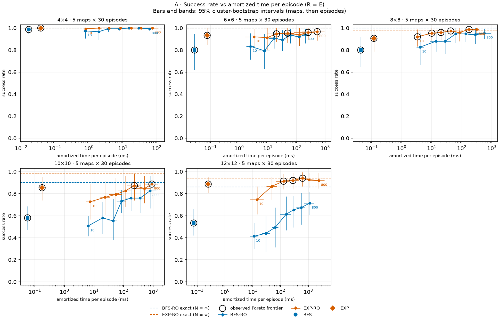

# frozen-lake

**Evaluating the Time-Performance Trade-off of BFS and Expectimax as Base Policies for Monte Carlo Rollout in Stochastic FrozenLake**

This research investigates whether investing more computation in an agent's *initial* decision rule pays off once that rule is refined by Monte Carlo Rollout under uncertainty. The testbed is the slippery Gymnasium [`FrozenLake-v1`](https://gymnasium.farama.org/environments/toy_text/frozen_lake/) environment, where every intended move can go wrong.

## Motivation

Rollout is a simple and widely used policy-improvement technique: before acting, simulate what would happen after each possible action if a *base policy* took over afterwards, then pick the most promising action. The quality of those simulations depends on the base policy, and so does their cost.

A cheap base policy, such as one derived from deterministic shortest paths, ignores the risk of slipping. A more sophisticated one, such as depth-limited Expectimax, reasons about stochastic outcomes but costs more to build. It is not obvious whether that extra reasoning still matters once Rollout's own sampling corrects for risk, or whether the cheaper policy delivers comparable success for a fraction of the computation.

## Research question

> How does the choice of base policy (BFS or Expectimax) affect the trade-off between computational time and success rate in Monte Carlo Rollout across stochastic FrozenLake environments of increasing size?

**Objective:** determine whether the potential performance gains of a more sophisticated base policy justify its additional computational cost.

### Hypotheses

These are open questions to be tested, not expected results.

- **H1 — Quality:** with the same number of rollout samples, Rollout over Expectimax may reach higher success rates than Rollout over BFS on some maps, because its base policy accounts for transition risk.
- **H2 — Cost:** building the Expectimax policy requires more work than building the BFS policy; once both are stored, looking up an action costs about the same.
- **H3 — Sampling budget:** more rollout samples per action may improve value estimates at a higher decision cost, but success need not increase monotonically.
- **H4 — Trade-off:** the simpler BFS base may give competitive success per unit of amortized computation, even where Expectimax improves absolute success.
- **H5 — Scaling:** map size, hole layout, horizon and reward sparsity may substantially change the observed differences.

Conclusions will be limited to the measured settings: environment parameters, maps, budgets, heuristic and hardware.

## Findings

The study's run covers lakes from 4×4 to 12×12, five maps per size, 30 paired episodes per map and seven Rollout budgets, from `N = 10` to `N = 800` trajectories per action: 13,500 real episodes. In brief:

- **The base policy matters more than the sampling budget.** With the same `N`, Rollout over Expectimax succeeds more often than Rollout over BFS, and the gap grows with the lake: on 12×12 lakes it ranges from 21 to 43 percentage points. It narrows as `N` grows, since enough samples correct much of a weak base policy.
- **The cost of a better base is indirect.** Building the Expectimax policy costs about five times as much as BFS, but only a few milliseconds. The larger cost comes later: simulations that follow the safer policy survive longer, so each Rollout decision over Expectimax costs up to 1.8 times as much.
- **The best trade-offs need little or no Rollout.** Expectimax alone is on the observed Pareto frontier of success versus time at every size; Rollout over BFS never is. A small budget can even make Rollout worse than its own base policy.



*Success rate against amortized computation time per episode, one panel per lake size. Better is up and to the left; circled points are on the observed Pareto frontier.*

The full analysis, with every figure, the paired comparisons, their uncertainty and the limitations, is in **[REPORT.md](REPORT.md)**.

## Approach

The agent moves on an `n × n` grid of frozen tiles (`F`), holes (`H`), a start (`S`) and a goal (`G`). Movement is stochastic: the intended direction succeeds with probability **0.80**, and the agent slips to each perpendicular direction with probability **0.10**. Reaching the goal yields reward 1; every other transition yields 0.

Two **base policies** are precomputed once per map as state → action tables:

| Base policy | Idea | Models slipping? |
|---|---|---|
| **BFS** | Reverse breadth-first search from the goal gives shortest deterministic distances; each state moves toward a neighbor with the smallest distance. | No |
| **Depth-limited Expectimax** | MAX nodes (agent actions) alternate with CHANCE nodes (probability-weighted outcomes), memoized by `(state, remaining_depth)`. Non-terminal leaves are scored with the heuristic `h(s) = β^d_BFS(s, G)`. | Yes |

A single shared **Monte Carlo Rollout** then improves either policy online: at every real state, it tries each of the four actions in `N` simulated trajectories, each taking that action first and following the base policy afterwards, and picks the action with the highest average return. When estimates tie, it keeps the base policy's action. As a reference, the same Rollout is also played with exact action values, computed from the known transition probabilities: the limit of an infinite `N`.

This yields four experimental strategies:

| ID | Real action rule |
|---|---|
| `BFS` | BFS base policy |
| `EXP` | Expectimax base policy |
| `BFS-RO` | Rollout over the BFS policy |
| `EXP-RO` | Rollout over the Expectimax policy |

The primary metric is **success rate versus amortized compute time per episode**. Supporting metrics are policy build time, paired-state decision time, simulated transitions, and search-specific counters such as visited states, queue peak, cache hits and recursion depth.

## Requirements

- [uv](https://docs.astral.sh/uv/). It downloads Python 3.12 automatically if needed.
- Linux, macOS or Windows, with a terminal that shows colors and Unicode (any current one, including Windows Terminal).
- Optional: Docker and VS Code with the Dev Containers extension.

## Quickstart

```bash
git clone https://github.com/Mariojamjam/frozen-lake.git
cd frozen-lake
uv tool install --editable .     # once: puts the frozen-lake command on the PATH
frozen-lake                      # every command and the typical workflow
```

If uv says its tools folder is not on the PATH, run `uv tool update-shell` once and open a new terminal. Without installing anything, `uv sync --locked` followed by `uv run frozen-lake …` runs every command in the project's locked environment; see the [command guide](docs/commands.md#2-install-the-frozen-lake-command) for both options. Run the commands from the project folder.

Every command explains itself with `-h`: what it does, its options grouped by topic, and examples to copy (`frozen-lake episode -h`).

### Explore the lake

```bash
frozen-lake tui -s 6
```

Choose an intended direction with the arrow keys and press **Space** to take one real step. The ice may slip the agent sideways (10% to each side), and the screen shows where the agent meant to go and where it actually landed. **R** replays the same episode seed, so the same actions reproduce the same slips; **N** tries the next episode seed (new slips on the same lake); **G** generates the next map seed (a new lake); **?** shows help; **Q** quits. The lake size (`-s`) is required; `frozen-lake tui -h` lists every other option, such as the seeds (`-m`, `-e`).

The explorer starts in **manual** mode, where the arrow keys choose. Press **1** for the **BFS policy**, **2** for the **Expectimax policy**, **3** for **Rollout over BFS** and **4** for **Rollout over Expectimax**, and **M** to return to manual; switching mode restarts the episode. **A** plays the episode automatically. In Rollout modes a table shows every action's estimate and whether Rollout overrode its base policy. **P** cycles the arrows drawn on the lake between off, the BFS policy and the Expectimax policy.

The settings can change without leaving the explorer: **+** and **-** move N, the Rollout trajectories per action, along the experiment's budgets; **]** and **[** change the Expectimax depth; **S** opens a window to type N, depth, beta and horizon. Each change restarts the episode on the same seed, so the same slips meet the new decisions.

### Play one episode

```bash
frozen-lake episode
```

In a terminal, with no options, a short form opens to choose the strategy and its settings. It enables only the settings that strategy uses, marks invalid values, and shows the equivalent command line as you type. The episode then prints every real step (state, action, where the agent landed, whether it slipped) and a summary with the ending (`goal`, `hole` or `timeout`) and the agent's computation time. The same episode from the command line:

```bash
frozen-lake episode -S EXP-RO -s 6 -e 7 -n 100    # Rollout over Expectimax, N = 100
```

`-S` picks the strategy (`BFS`, `EXP`, `BFS-RO`, `EXP-RO`), `-q` prints only the summary, and `frozen-lake episode -h` lists every option.

### Run the experiment

```bash
frozen-lake validate                  # check the configuration
frozen-lake benchmark --dry-run       # describe the run
frozen-lake benchmark                 # run it (asks before starting)
```

`configs/experiment.toml` describes the whole experiment: lake sizes, maps, episodes, Rollout sample counts and the Expectimax settings; `-i` gives another configuration and `-o` another output folder. `benchmark` generates every map, builds and times each base policy, plays every strategy on the same maps and episode seeds, and writes raw CSV results, a summary and the run's metadata to a new folder under `results/generated/`, then checks them for completeness.

The study's run is kept in [`results/canonical/experiment-1/`](results/canonical/experiment-1/): its configuration, maps, raw CSV results, metadata, and the tables and figures in `analysis/`. To check it and regenerate the analysis from the saved data:

```bash
frozen-lake validate -i results/canonical/experiment-1
frozen-lake plot -i results/canonical/experiment-1
```

## Documentation

- [Research report](REPORT.md) — the results: success, cost and trade-offs of the four strategies, with figures, uncertainty and limitations.
- [Command guide](docs/commands.md) — setup, CLI commands and options, TUI controls, and common workflows.
- [Experimental design](docs/experiment-design.md) — the research question, strategies, metrics, fixed conditions, and analysis method.

## Development

```bash
uv run pytest -q              # tests
uv run ruff check .           # lint
uv run ruff format --check .  # format check
uv run ruff format .          # apply formatting
```

These run in the project's locked environment (`uv sync --locked` first). Running them in this order before pushing checks what CI checks.

### Dev Container

Open the folder in VS Code and choose **Dev Containers: Reopen in Container**. The image provides Python 3.12 and a pinned `uv`, runs `uv sync --locked` on creation, and puts the project's environment on the PATH, so `frozen-lake` works in its terminal right away.

### Continuous integration

GitHub Actions (`.github/workflows/ci.yml`) runs on every push to `main` and on every pull request. It installs the locked dependencies, then runs Ruff lint and format checks, pytest, and a CLI smoke test. CI never runs the full scientific benchmark.

## Repository layout

```text
frozen-lake/
├── .devcontainer/        # Dev Container (Dockerfile + devcontainer.json)
├── .github/workflows/    # CI
├── configs/              # The experiment configuration (experiment.toml)
├── docs/                 # Supplementary documentation
├── results/
│   ├── canonical/        # The study's run (experiment-1), with its analysis
│   └── generated/        # New runs (not tracked by git)
├── src/frozen_lake/      # Python package (import name: frozen_lake)
│   ├── cli.py            # Typer entry point for the `frozen-lake` command
│   ├── models.py         # Shared types: actions, tiles, transitions, results
│   ├── environment.py    # Maps, the real environment, transition model, sampler
│   ├── episodes.py       # Real episodes: one environment step per decision
│   ├── policies/         # Base policies: bfs.py, expectimax.py, shared utils.py
│   ├── rollout.py        # Monte Carlo Rollout over any base policy, and its exact reference
│   ├── experiments/      # The experiment runner: config, seeds, matrix, runner, records, validation
│   ├── analysis/         # Analysis of a finished run: bootstrap, tables, figures (the `plot` command)
│   └── tui/              # Textual explorer and the episode form
├── tests/                # pytest suite
├── REPORT.md             # Research report
├── pyproject.toml        # Project metadata, dependencies, Ruff/pytest config
└── uv.lock               # Locked dependency versions
```

## References

- Gymnasium FrozenLake: <https://gymnasium.farama.org/environments/toy_text/frozen_lake/>
- Textual: <https://textual.textualize.io/>
- AIMA Python (study reference): <https://github.com/aimacode/aima-python>
