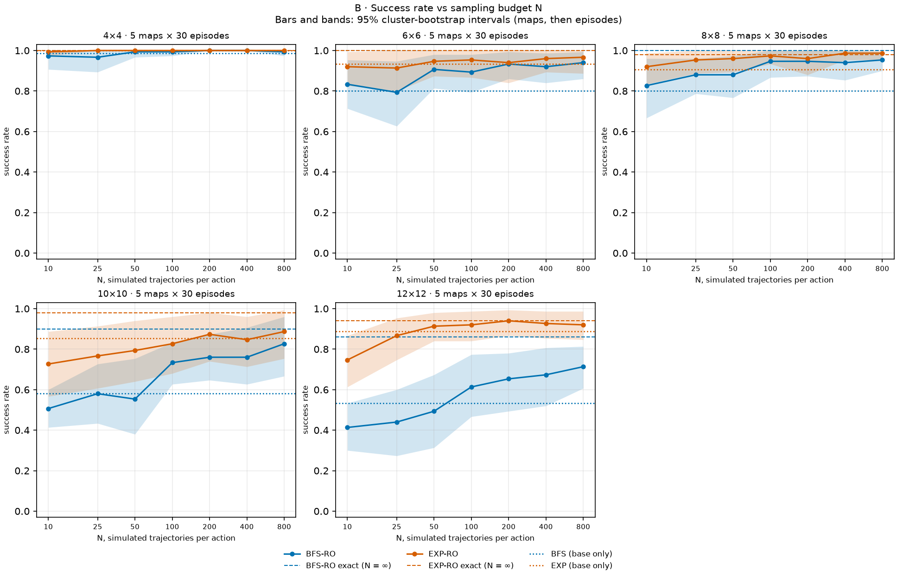
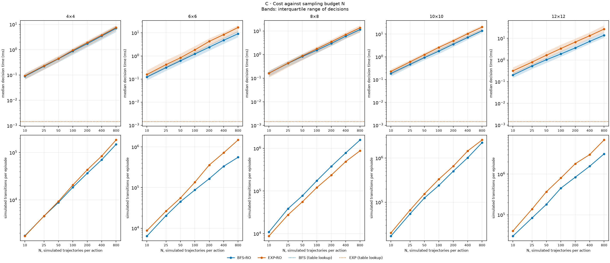
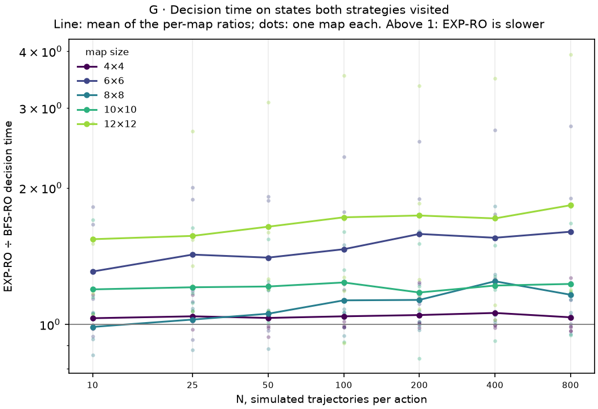
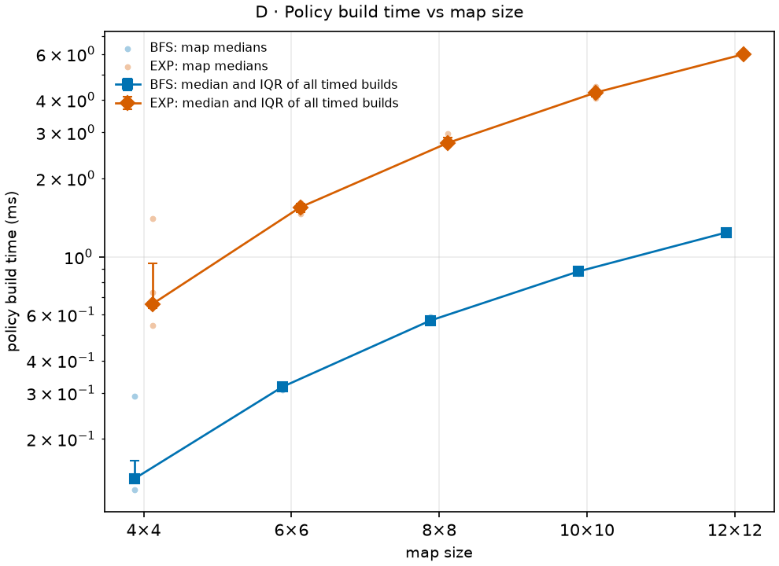
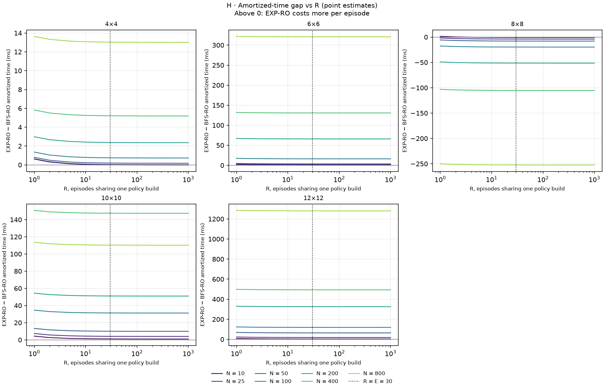
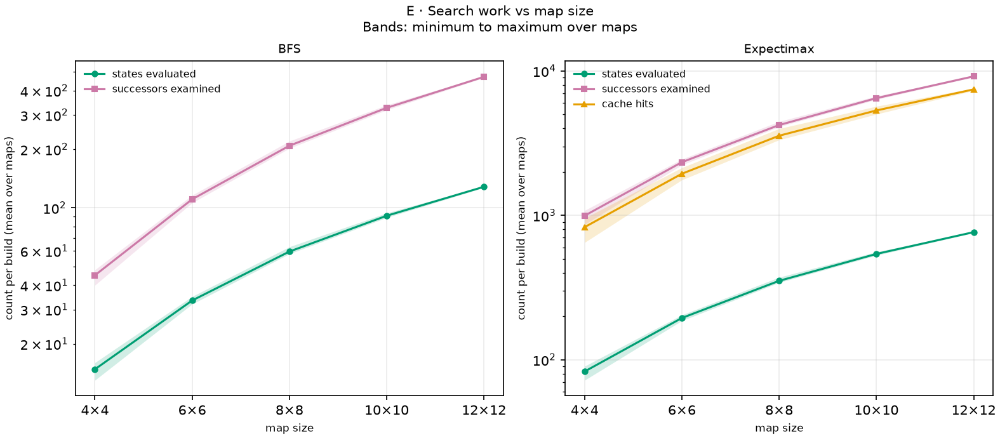
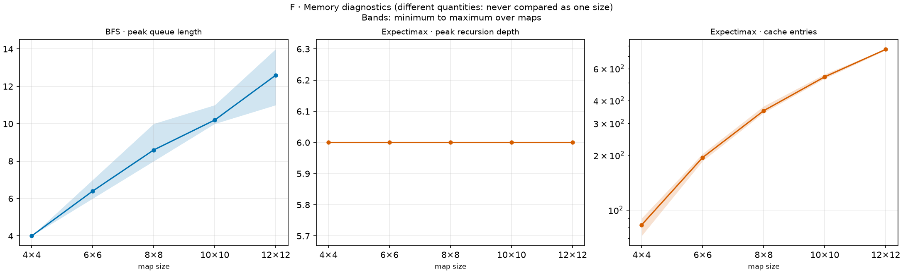

# Evaluating the Time-Performance Trade-off of BFS and Expectimax as Base Policies for Monte Carlo Rollout in Stochastic FrozenLake

> Results from [`results/canonical/experiment-1`](results/canonical/experiment-1/), produced by commit `e4c1903`. The full experimental design, with every definition and its justification, is in [`docs/experiment-design.md`](docs/experiment-design.md); this report is self-contained and cites it only for further detail.

## Contents

1. [Summary](#1-summary)
2. [Question](#2-question)
3. [The problem: slippery FrozenLake](#3-the-problem-slippery-frozenlake)
4. [Strategies](#4-strategies)
5. [Method](#5-method)
6. [Results](#6-results)
7. [Discussion](#7-discussion)
8. [Limitations](#8-limitations)
9. [Conclusion](#9-conclusion)
10. [Reproducing the results](#10-reproducing-the-results)
- [Appendix A. Every arm, every size](#appendix-a-every-arm-every-size)
- [Appendix B. Search work and memory](#appendix-b-search-work-and-memory)
- [Appendix C. Glossary](#appendix-c-glossary)

---

## 1. Summary

Monte Carlo Rollout improves a decision rule, the *base policy*, by simulating what follows each possible action before acting. This study asks whether it pays to give Rollout a better, more expensive base policy. In the slippery Gymnasium `FrozenLake-v1`, where every move goes in the intended direction only 80% of the time, the same Rollout was run over two base policies: breadth-first search (BFS), which finds the shortest route and ignores slipping, and a depth-limited Expectimax, which weighs every slip by its probability. Five map sizes, from 4×4 to 12×12, five maps per size, 30 paired episodes per map and seven sampling budgets give 13,500 real episodes.

Three findings:

1. **Quality.** With the same sampling budget, Rollout over Expectimax succeeds more often than Rollout over BFS, and the gap grows with the map. On 12×12 lakes it ranges from +21 percentage points (pp) with 800 samples per action to +43 pp with 25. The gap narrows as the budget grows, and with exact action values (an infinite budget) it falls to +8 pp, within noise.
2. **Cost.** Building the Expectimax policy costs about five times as much as BFS, but only about 6 ms per 12×12 map, which is negligible next to Rollout. The larger cost is indirect: simulations that follow the safer Expectimax policy survive longer, so on the same states a Rollout decision over Expectimax costs more than one over BFS, up to 1.8 times as much on 12×12 lakes.
3. **Trade-off.** The Expectimax policy alone is on the observed Pareto frontier of success versus time at every map size: on 12×12 lakes it succeeds in 88.7% of episodes at 0.25 ms per episode. Rollout over BFS is never on the frontier. Rollout over Expectimax reaches it only at the high-success end, paying tens to thousands of times the computation of Expectimax alone for 1 to 8 pp more success, with overlapping intervals.

Under these conditions, computation spent on the base policy buys far more success than computation spent on sampling.

## 2. Question

An agent that must act under uncertainty can invest computation at two moments. It can plan *before* acting, building a decision rule that covers every state; or it can think *while* acting, checking each decision by simulation. Monte Carlo Rollout is a generic way to do the second: at every real step, it tries each action in simulation, follows a fixed base policy afterwards, and takes the action whose simulations went best. Rollout never re-plans; it only refines the base policy it is given, so its results depend on that policy.

A better base policy costs more to build. A cheap policy may be good enough once Rollout corrects it, or a careful one may be what makes Rollout work. This study measures that choice:

> **How does the choice of base policy, BFS or depth-limited Expectimax, affect the trade-off between success rate and amortized computation time of a single shared Monte Carlo Rollout in stochastic FrozenLake, across map sizes?**

The hypotheses were stated as questions before the experiment ran:

- **H1 (quality).** With equal sampling budgets, does Rollout over Expectimax reach higher success than Rollout over BFS?
- **H2 (cost).** Does building Expectimax cost more than building BFS, while looking up an action costs the same?
- **H3 (sampling budget).** Do more samples per action improve success, at a higher decision cost, and is the improvement monotonic?
- **H4 (trade-off).** Is the simpler BFS base competitive in success per unit of computation?
- **H5 (scaling).** Does map size change the differences?

## 3. The problem: slippery FrozenLake

An agent crosses a frozen lake on a square grid, from the start tile `S` in the top-left corner to the goal `G` in the bottom-right. Tiles are ice (`F`) or holes (`H`). This is one of the 8×8 lakes of the experiment (map `8-1`):

```text
S F F F F F F H
F F F F F F F F
F F F F F F F F
F F F F F F F F
F F F F F F F F
F H F F H F F F
F F H F F F F F
F F F F F H F G
```

At each step the agent chooses LEFT, DOWN, RIGHT or UP. The ice is slippery: the move goes in the intended direction with probability 0.8, and to each of the two perpendicular directions with probability 0.1. A move into the border leaves the agent where it is.

```text
                 0.1  ↑
   intended →   ●  →  0.8
                 0.1  ↓
```

An episode ends when the agent reaches the goal (reward 1, a **success**), falls into a hole (reward 0) or uses up its step limit (a timeout, reward 0). The **success rate** is the fraction of episodes that reach the goal.

Slipping is what makes the problem interesting: **the shortest route is not the safest.** A route that passes between two holes is short, but every step on it risks a lateral slip into one of them. A longer route along open ice may succeed far more often. Every fall into a hole in this environment comes from a slip, since no policy in the study steps into a hole on purpose.

## 4. Strategies

The study compares four strategies built from two base policies and one Rollout implementation.

**BFS** computes, by a breadth-first search backwards from the goal, the number of moves from every tile to the goal on a slip-free version of the lake, avoiding holes. On each tile it chooses the move that shortens that distance. It is cheap and optimal if nothing slips, but it is blind to risk: it treats a route between holes like any other route of the same length.

**Expectimax (EXP)** looks 6 decisions ahead and weighs every outcome, the intended move and both slips, by its probability. Where the look-ahead stops on an ice tile, it scores the tile by a heuristic, $h(s) = \beta^{d(s)}$ with $\beta = 0.9$, where $d(s)$ is the BFS distance to the goal: a progress score that is higher the closer the tile is to the goal, not a probability. Holes score 0. Because it sees the probability of slipping, Expectimax can prefer a longer, safer route. Its cost includes the BFS distances it needs for the heuristic.

Both base policies are computed once per map, for every tile, and stored as a table. Choosing an action is then a single table lookup.

**Rollout (BFS-RO and EXP-RO)** decides at every real step. From the current tile, each of the four actions is tried in $N$ simulated trajectories: the action first, then the base policy, until the goal, a hole or the simulation horizon. The action whose $N$ trajectories reached the goal most often is taken; in a tie, the base policy's action is kept. A larger $N$ gives more precise estimates and costs proportionally more. BFS-RO and EXP-RO run exactly the same Rollout code: only the base table differs.

**Exact reference.** For each base policy, the experiment also plays Rollout with exact action values instead of sampled ones, computed by dynamic programming over the known transition probabilities. It is the limit of Rollout as $N$ grows without bound. It shows how much of each Rollout's shortfall is sampling noise; its time is not comparable with sampling, so it is left out of every cost comparison.

| Strategy | Decides by | Cost |
|---|---|---|
| **BFS** | Table lookup of the shortest-route move | Cheapest build; lookup per step |
| **EXP** | Table lookup of the Expectimax move (depth 6) | More expensive build, including BFS; lookup per step |
| **BFS-RO** | $4N$ simulations per step, then BFS | BFS build plus simulations at every step |
| **EXP-RO** | $4N$ simulations per step, then Expectimax | Expectimax build plus simulations at every step |
| BFS-RO / EXP-RO exact | Exact action values ($N = \infty$) | Reference line only |

The definitions in full are in sections 4 and 5 of the [experimental design](docs/experiment-design.md#4-the-two-base-policies).

## 5. Method

### 5.1 Metrics

**Success rate.** The fraction of episodes that reach the goal, estimated per map and then averaged over the maps of a size, so that each map counts once.

**Amortized time per episode.** A base policy is built once per map and then serves many episodes, so its build time is shared among them. The cost of strategy $k$ on map $m$ is

$$
T_k(m) = \frac{B_k(m)}{R} + A_k(m),
$$

where $B_k(m)$ is the median build time of the base policy, $A_k(m)$ the mean time the agent spends deciding during an episode, and $R = 30$ the number of episodes each strategy plays on the map. Simulation time is part of $A_k(m)$; the environment's own stepping time is not.

**Pareto frontier.** A strategy *dominates* another if it is at least as fast and at least as successful, and strictly better in one of the two. The strategies that no other dominates form the observed frontier: the best available trade-offs. Success and time are always reported together, because a strategy that fails early can look cheap.

### 5.2 Fixed conditions

Every setting was fixed in [`configs/experiment.toml`](configs/experiment.toml) before the experiment ran, and none was changed afterwards.

| Group | Setting |
|---|---|
| Environment | Gymnasium `FrozenLake-v1`, slippery, `success_rate = 0.8` (0.1 to each perpendicular direction); reward 1 on reaching the goal, 0 otherwise; no discounting ($\gamma = 1$) |
| Maps | Square, sizes 4, 6, 8, 10 and 12; each tile ice with probability 0.9; `S` top-left, `G` bottom-right; 5 maps per size, each with a route from start to goal |
| Episodes | 30 per map and strategy; step limit $4n^2$ (64 on 4×4, 576 on 12×12), the same for every strategy |
| Expectimax | Depth 6; heuristic $\beta = 0.9$ |
| Rollout | $N \in \{10, 25, 50, 100, 200, 400, 800\}$ trajectories per action; horizon $\min(2n^2,\ \text{steps left})$; ties keep the base action, then the order RIGHT, DOWN, LEFT, UP; plus the exact reference for each base |
| Policy builds | 30 timed builds per map and base policy, after one untimed warm-up; median used |
| Seeds | Master seed 2026; every map, episode and simulation seed derived from it by SHA-256; every strategy plays the same maps and episode seeds |
| Volume | 18 strategy–budget combinations × 5 sizes × 5 maps × 30 episodes = 13,500 real episodes |
| Machine | AMD Ryzen 5 5500U (laptop CPU), in the project's Dev Container; Python 3.12.11, Gymnasium 1.4.0, NumPy 2.5.4; one sequential process; 34 minutes in total |
| Provenance | Commit `e4c1903` (clean working tree); configuration hash `c1371dcb…`; map hash `db799fc8…`; all recorded in the run's [`metadata.json`](results/canonical/experiment-1/metadata.json) |

> **Note on $\beta$.** $\beta$ stays at 0.9 throughout this report. As a brief check outside the fixed protocol, the experiment was also run with $\beta = 0.85$ and $\beta = 0.95$ on the same seeds. The conclusions did not change: the Expectimax base outperformed the BFS base at every $\beta$, and $\beta = 0.95$ raised the success of the Expectimax strategies slightly (by about 2 pp overall). Anyone can repeat the check by changing `policies.heuristic_beta` in `configs/experiment.toml` and running the experiment again.

### 5.3 Pairing

Every strategy plays the same maps, and within a map the same episode seeds, so the real environment's slips start from the same random stream for all of them. Differences are computed map by map and then averaged. This removes the variation between maps from the comparison, which would otherwise dominate it, since some maps are much harder than others. Each sampled Rollout has its own simulation stream, so changing $N$ never changes the real environment's randomness.

### 5.4 Statistics

Uncertainty has two levels: episodes vary within a map, and maps vary within a size. Intervals come from a cluster bootstrap that follows both: resample the five maps with replacement, resample the 30 episodes within each chosen map, recompute every estimate, and repeat 2,000 times. Each interval is the central 95% of the resampled estimates. The same resample is applied to all strategies at once, so paired differences keep their pairing. With five maps per size, these intervals are approximate and should be read as such.

### 5.5 Data checks

Before any analysis, the run was checked for completeness: every map, episode and strategy is present exactly once, every strategy of an episode shares its seed, every episode's decisions add up to its steps, and every saved map matches its seed. Three further checks describe the data:

- **Fallback.** Only one tile in the whole experiment has no route to the goal (on map `12-3`), and no agent ever stood on it: none of the 525,649 logged decisions was taken there.
- **Timeouts.** One episode in 13,500 ended by the step limit; all others ended at the goal or in a hole.
- **Ceiling.** On 4×4 lakes, 11 of the 18 strategy–budget combinations succeed in every episode, and none falls below 96%. This size does not separate the strategies.

## 6. Results

All numbers in this section come from the tables in [`results/canonical/experiment-1/analysis/tables/`](results/canonical/experiment-1/analysis/tables/), produced by `frozen-lake plot` from the saved raw data. Success rates are percentages; differences are in percentage points (pp). Intervals are 95% cluster-bootstrap intervals.

### 6.1 Success by map size

Table 1 shows the success rate of each strategy at three of the seven sampling budgets; Appendix A has all of them, with intervals.

**Table 1.** Success rate (%) by strategy and map size.

| Strategy | 4×4 | 6×6 | 8×8 | 10×10 | 12×12 |
|---|---:|---:|---:|---:|---:|
| BFS | 98.7 | 80.0 | 80.0 | 58.0 | 53.3 |
| BFS-RO, N = 10 | 97.3 | 83.3 | 82.7 | 50.7 | 41.3 |
| BFS-RO, N = 100 | 99.3 | 89.3 | 94.7 | 73.3 | 61.3 |
| BFS-RO, N = 800 | 99.3 | 94.0 | 95.3 | 82.7 | 71.3 |
| BFS-RO, exact | 100.0 | 100.0 | 100.0 | 90.0 | 86.0 |
| EXP | 100.0 | 93.3 | 90.7 | 85.3 | 88.7 |
| EXP-RO, N = 10 | 99.3 | 92.0 | 92.0 | 72.7 | 74.7 |
| EXP-RO, N = 100 | 100.0 | 95.3 | 97.3 | 82.7 | 92.0 |
| EXP-RO, N = 800 | 100.0 | 96.7 | 98.7 | 88.7 | 92.0 |
| EXP-RO, exact | 100.0 | 100.0 | 98.0 | 98.0 | 94.0 |

Four patterns stand out:

- **4×4 is at the ceiling.** Every strategy succeeds in at least 97% of episodes, so this size does not separate them.
- **BFS degrades with size; Expectimax does not.** BFS falls from 80% on 6×6 to 53% on 12×12, while Expectimax stays between 85% and 93%. On 12×12 lakes Expectimax alone succeeds 35 pp more often than BFS.
- **A small sampling budget hurts.** With $N = 10$, Rollout does *worse* than its own base policy on the large maps: BFS-RO 41% against BFS 53% on 12×12, EXP-RO 75% against EXP 89%.
- **Sampling noise is what holds Rollout over BFS back.** On 12×12, BFS-RO reaches 71% with $N = 800$, while its exact reference reaches 86%: 15 pp are lost to noise even at the largest budget. EXP-RO, in contrast, is within 2 pp of its exact reference (94%) from $N = 100$ on.

Figure B shows the same data for every budget. *How to read it:* each panel is one map size; the horizontal axis is $N$ on a log scale; solid lines with shaded 95% bands are BFS-RO (blue) and EXP-RO (orange); dotted lines are the base policies alone; dashed lines are the exact references, the ceiling each Rollout approaches as $N$ grows.



On 10×10 and 12×12 the orange line stays above the blue one at every budget, and the blue line needs $N \approx 100$ just to climb above its own dotted base line. Neither curve rises monotonically: success moves up and down by a few points between neighboring budgets, within the bands.

### 6.2 The trade-off

Figure A is the study's main result: every strategy as one point of success against cost. *How to read it:* the horizontal axis is the amortized time per episode in milliseconds, on a log scale; the vertical axis is the success rate. Square and diamond markers are BFS and EXP alone; the connected points are BFS-RO and EXP-RO, from $N = 10$ (left) to $N = 800$ (right); dashed lines are the exact references; bars are 95% intervals in both directions. Points circled in black are on the observed Pareto frontier. Better is up and to the left.


Two facts dominate the picture. First, the base policies alone cost about a hundredth of a millisecond to a quarter of a millisecond per episode, while Rollout costs from about one millisecond to over two seconds: two to four orders of magnitude more. Second, on the large maps the Expectimax diamond sits *above* most of the BFS-RO line, at a small fraction of its cost.

**Table 2.** Strategies on the observed Pareto frontier, from cheapest to most expensive.

| Size | On the observed frontier (success, amortized ms per episode) |
|---|---|
| 4×4 | BFS (98.7%, 0.02); EXP (100.0%, 0.04) |
| 6×6 | BFS (80.0%, 0.03); EXP (93.3%, 0.08); EXP-RO N = 50 (94.7%, 20.0); EXP-RO N = 100 (95.3%, 48.2); EXP-RO N = 400 (96.0%, 253); EXP-RO N = 800 (96.7%, 524) |
| 8×8 | BFS (80.0%, 0.04); EXP (90.7%, 0.12); EXP-RO N = 10 (92.0%, 3.34); EXP-RO N = 25 (95.3%, 10.1); EXP-RO N = 50 (96.0%, 20.2); EXP-RO N = 100 (97.3%, 43.0); EXP-RO N = 400 (98.7%, 174) |
| 10×10 | BFS (58.0%, 0.06); EXP (85.3%, 0.18); EXP-RO N = 200 (87.3%, 229); EXP-RO N = 800 (88.7%, 900) |
| 12×12 | BFS (53.3%, 0.08); EXP (88.7%, 0.25); EXP-RO N = 50 (91.3%, 129); EXP-RO N = 100 (92.0%, 278); EXP-RO N = 200 (94.0%, 623) |

BFS and EXP alone are on the frontier at every size: BFS because nothing is cheaper, EXP because nothing reaches its success for less. **BFS-RO is never on the frontier**, at any size or budget: at every point, Expectimax alone is both cheaper and at least as successful, except where BFS-RO's success exceeds that of Expectimax (on 6×6 with $N = 800$ and on 8×8 with $N \ge 100$); there, a cheaper EXP-RO dominates it instead. EXP-RO enters the frontier only beyond EXP, buying 1 to 8 pp of success for 28 to about 6,800 times the computation, with intervals that overlap those of EXP alone.

### 6.3 Expectimax base versus BFS base, paired

The study's central contrast is the paired difference in success between the two Rollout strategies at equal budget, computed map by map. Bold entries are those whose interval excludes zero.

**Table 3.** Success of EXP-RO minus success of BFS-RO (pp), with 95% intervals.

| N | 4×4 | 6×6 | 8×8 | 10×10 | 12×12 |
|---|---:|---:|---:|---:|---:|
| 10 | +2 [+0, +7] | +9 [-2, +22] | +9 [-3, +25] | **+22 [+5, +37]** | **+33 [+15, +51]** |
| 25 | +3 [+0, +11] | **+12 [+2, +24]** | **+7 [+1, +15]** | **+19 [+5, +32]** | **+43 [+28, +57]** |
| 50 | +1 [+0, +3] | +4 [-3, +13] | **+8 [+1, +16]** | **+24 [+7, +43]** | **+42 [+23, +61]** |
| 100 | +1 [+0, +3] | +6 [-4, +18] | +3 [-2, +9] | +9 [-9, +25] | **+31 [+13, +48]** |
| 200 | +0 [+0, +0] | +1 [-6, +7] | +1 [-3, +7] | +11 [-7, +27] | **+29 [+17, +41]** |
| 400 | +0 [+0, +0] | +4 [-2, +12] | +5 [-1, +14] | +9 [-10, +25] | **+25 [+10, +42]** |
| 800 | +1 [+0, +3] | +3 [-3, +9] | +3 [-1, +9] | +6 [-15, +28] | **+21 [+6, +35]** |
| exact | +0 [+0, +0] | +0 [+0, +0] | -2 [-7, +0] | +8 [+0, +19] | +8 [-2, +20] |

- **The difference is never reliably negative.** Its only negative estimate, −2 pp for the exact reference on 8×8, has an interval that reaches zero.
- **It grows with map size.** Up to 8×8 it is a few points and mostly within noise; on 10×10 it is about +20 pp for small budgets; on 12×12 it is reliably positive at every budget, between +21 and +43 pp.
- **It shrinks as $N$ grows.** On 12×12 it falls from +43 pp ($N = 25$) to +21 pp ($N = 800$), and with exact values to +8 pp, whose interval includes zero. With few samples, Rollout inherits the weaknesses of its base policy; with many, it corrects most of them, and the choice of base matters less.

### 6.4 Where the cost comes from

Figure C separates the cost of sampling into its two parts. *How to read it:* the top row is the median time of one decision (with its interquartile range) against $N$; the bottom row is the mean number of simulated transitions per episode. Both axes are logarithmic. Dotted lines in the top row are the table lookups of BFS and EXP alone.



Decision time grows in proportion to $N$, as expected: on 12×12 a BFS-RO decision takes a median of 0.20 ms at $N = 10$ and 13.9 ms at $N = 800$. A table lookup takes 1.5 µs for either base policy. On the large maps the orange line lies above the blue one: **a Rollout decision over Expectimax costs more than one over BFS.**

Comparing whole episodes mixes the cost of a decision with the number of decisions, since a strategy that survives longer decides more often. Figure G removes that effect: on each map, it compares the decision times of the two Rollout strategies only on the tiles where both took decisions. *How to read it:* the vertical axis is the ratio of EXP-RO to BFS-RO decision time; above 1, EXP-RO is slower. Lines are the mean over maps; dots are single maps.



Table 4 explains why. Each simulated trajectory follows the base policy until it reaches the goal, falls into a hole or hits the horizon. The Expectimax policy avoids holes better, so its simulated trajectories last longer, and each costs more.

**Table 4.** Mean simulated steps per trajectory and real steps per episode (averaged over the seven budgets), and the decision-time ratio on shared states.

| Size | Simulated steps per trajectory, BFS-RO / EXP-RO | Real steps per episode, BFS-RO / EXP-RO | Decision time on shared states, EXP-RO ÷ BFS-RO (range over N) |
|---|---:|---:|---:|
| 4×4 | 5.4 / 5.7 | 8.4 / 8.8 | 1.03–1.06 |
| 6×6 | 8.1 / 13.5 | 24.6 / 25.7 | 1.31–1.60 |
| 8×8 | 10.7 / 11.4 | 39.5 / 24.4 | 0.99–1.25 |
| 10×10 | 12.4 / 17.1 | 47.8 / 44.2 | 1.18–1.24 |
| 12×12 | 13.8 / 25.3 | 69.0 / 70.6 | 1.54–1.83 |

On 12×12 lakes an EXP-RO simulation lasts 25 steps on average against 14 for BFS-RO, and on the same states an EXP-RO decision costs 1.5 to 1.8 times as much. **A better base policy makes every simulation more expensive.** This cost does not appear in the build time; it is paid at every decision.

The 8×8 maps are the exception that confirms the role of episode length. There, simulated trajectories have similar lengths under both bases, but BFS-RO episodes last 40 real steps against 24 for EXP-RO, because BFS-RO wanders longer before reaching the goal or a hole. More steps mean more decisions, and on 8×8 EXP-RO is therefore *cheaper* per episode than BFS-RO, by a margin whose interval excludes zero from $N = 25$ to $N = 400$.

### 6.5 Building the policies

**Table 5.** Median build time of each base policy, and median Rollout decision time for comparison.

| Size | BFS build (ms) | EXP build (ms) | EXP ÷ BFS | Median decision, N = 10, BFS-RO / EXP-RO (ms) | Median decision, N = 800, BFS-RO / EXP-RO (ms) |
|---|---:|---:|---:|---:|---:|
| 4×4 | 0.14 | 0.66 | 4.7 | 0.09 / 0.09 | 7.0 / 7.5 |
| 6×6 | 0.32 | 1.55 | 4.9 | 0.12 / 0.16 | 9.1 / 17.1 |
| 8×8 | 0.57 | 2.74 | 4.8 | 0.16 / 0.16 | 11.5 / 13.8 |
| 10×10 | 0.88 | 4.27 | 4.9 | 0.19 / 0.23 | 14.0 / 20.4 |
| 12×12 | 1.24 | 5.99 | 4.8 | 0.20 / 0.32 | 13.9 / 26.8 |

Building Expectimax costs about 4.8 times as much as building BFS at every size, including the BFS distances its heuristic needs (Figure D). But a whole Expectimax build on a 12×12 lake, about 6 ms, costs less than a single Rollout decision with $N = 800$. Figures E and F, in Appendix B, show the same growth in terms of search work and memory, independent of the machine's speed.



Because the build is so cheap next to the decisions, the number of episodes $R$ that share one build barely matters. Figure H shows the difference in amortized time between EXP-RO and BFS-RO as $R$ goes from 1 to 1,000. *How to read it:* one line per budget $N$; above 0, EXP-RO costs more per episode; the dotted vertical line marks $R = 30$, the value used everywhere else.



The lines are nearly flat. Only at the smallest budget does $R$ make a visible difference: on 12×12 with $N = 10$, the gap falls from 7.9 ms per episode at $R = 1$ to 3.3 ms at $R = 30$, and stays at 3.2 ms for $R = 1{,}000$. The conclusions on cost would be the same with any $R$ in that range.

## 7. Discussion

This section returns to the five hypotheses, then discusses what the results say about Rollout itself, where computation is best spent, and how far the conclusions reach. Statements marked as *interpretation* explain a measured pattern but were not measured directly.

**Table 6.** Verdict on each hypothesis.

| Hypothesis | Verdict | Main evidence |
|---|---|---|
| H1. Rollout over Expectimax is more successful at equal budget | Supported on 10×10 and 12×12; inconclusive on smaller maps | Table 3, Figure B |
| H2. Expectimax costs more to build; lookups cost the same | Supported; the build cost is negligible in absolute terms | Table 5, Figure D |
| H3. More samples help, at a higher cost, not necessarily monotonically | Partly supported: on average yes, but small budgets are harmful and EXP-RO saturates early | Tables 1 and 5, Figures B and C |
| H4. The BFS base is competitive in success per unit of computation | Not supported for Rollout over BFS; BFS alone is competitive only as the cheapest option | Table 2, Figure A |
| H5. Map size changes the differences | Supported: the differences appear only from 10×10 on | Tables 1 and 3 |

### 7.1 H1: the quality of the base policy

**Expected.** Expectimax accounts for the risk of slipping and BFS does not, so Rollout over Expectimax might reach higher success with the same budget.

**Found.** On 12×12 lakes, EXP-RO beats BFS-RO at every budget, by +21 to +43 pp, with every interval above zero; on 10×10 the advantage is about +20 pp for budgets up to 50 (Table 3). On maps up to 8×8 the estimates are positive but small, and only three of the twenty-one comparisons there exclude zero (6×6 with $N = 25$; 8×8 with $N = 25$ and $N = 50$). No comparison is reliably negative.

**Why.** Rollout evaluates each action by following the base policy afterwards. Each simulated trajectory is therefore a sample of what the base policy achieves from the next tile. A risk-blind base walks close to holes inside the simulations as well, so its trajectories fail often, and the estimates of all four actions are low and close together. A safer base gives estimates that separate good actions from bad ones more clearly.

*Interpretation.* There is also a statistical reason. Each trajectory returns 1 or 0, so its standard error is $\sqrt{p(1-p)/N}$, where $p$ is the chance that the trajectory succeeds. That error is largest at $p = 0.5$ and shrinks as $p$ approaches 1. On 12×12 lakes BFS alone succeeds about half the time and Expectimax about 89% of the time; at these two values the standard error is $0.50/\sqrt{N}$ and $0.32/\sqrt{N}$. With the same $N$, Rollout over Expectimax would have estimates about 1.6 times as precise. This is consistent with what Table 3 shows: the gap between the two Rollouts is largest when $N$ is small, where precision matters most.

**Caveat.** With five maps per size, the comparisons on small maps cannot detect differences of a few points. "Inconclusive" there means "too small to measure with this design", not "no difference".

### 7.2 H2: the cost of the base policy

**Expected.** Expectimax evaluates every outcome of every action several steps ahead, so it should take longer to build than a breadth-first search; once both are tables, choosing an action should cost the same.

**Found.** The Expectimax build takes about 4.8 times as long as BFS at every size, with the BFS distances for its heuristic included (Table 5). Its search work grows the same way (Figure E): on 12×12 lakes it evaluates about 760 states and examines about 9,200 successors per build, against about 130 and 470 for BFS. A table lookup takes 1.5 µs for either policy.

**Why it matters less than expected.** Expectimax is affordable here because the memo table stores each (tile, remaining depth) pair once: on 12×12 lakes about 760 entries answer about 7,500 repeated lookups. The whole build, about 6 ms, costs less than a single Rollout decision with $N = 800$. The cost hypothesis is true, but in this setting the direct cost of a better base is not what limits it; the indirect cost in Section 7.6 is larger.

### 7.3 H3: the sampling budget

**Expected.** More samples per action should give more precise estimates and better decisions, at a cost proportional to $N$, without a guarantee of steady improvement.

**Found.** Cost is proportional to $N$: on 12×12 a BFS-RO decision takes a median of 0.20 ms at $N = 10$, 1.90 ms at $N = 100$ and 13.9 ms at $N = 800$ (Figure C). Success rises on average, but the two Rollouts behave differently:

- **BFS-RO keeps improving and never arrives.** On 12×12 it rises from 41% at $N = 10$ to 71% at $N = 800$, still 15 pp below its exact reference (86%). Even 800 samples per action are not enough to extract what the exact values contain.
- **EXP-RO saturates early.** On 12×12 it is within 2 pp of its exact reference (94%) from $N = 100$ on; beyond that, more samples buy nothing measurable.
- **Neither is monotonic.** Success sometimes drops between neighboring budgets, for example BFS-RO on 10×10 from 58% at $N = 25$ to 55% at $N = 50$, or EXP-RO on 12×12 from 94% at $N = 200$ to 92% at $N = 800$. These drops are within the intervals and should not be read as effects.
- **Small budgets are harmful** (Section 7.6).

### 7.4 H4: is the cheap base competitive?

**Expected.** BFS might give competitive success per unit of computation even where Expectimax is more successful in absolute terms.

**Found.** For Rollout, no: BFS-RO is never on the observed frontier, at any size or budget (Table 2). BFS alone is always on the frontier, but only because nothing is cheaper; on 12×12 it saves about 0.17 ms per episode compared with Expectimax and loses 35 pp of success. Section 7.7 puts numbers on this comparison.

**Why.** The comparison is decided by two orders of magnitude. Any Rollout costs at least about a millisecond per episode, while either base policy costs a fraction of one. For BFS-RO to be on the frontier, it would have to beat Expectimax alone in success, which a risk-blind base with noisy estimates does not manage on the larger maps.

### 7.5 H5: the role of map size

**Expected.** Size, layout and horizon might change the differences substantially.

**Found.** Up to 8×8 all strategies are within a few points of each other; on 10×10 and 12×12 the differences reach tens of points (Tables 1 and 3). The change comes almost entirely from BFS: its success falls from 80% on 8×8 to 53% on 12×12, while Expectimax stays between 85% and 91% over the same range.

**Why.** A larger lake means a longer route to the goal: the median episode lasts 8 real steps on 4×4 and 54 on 12×12. Each step is another chance of a lateral slip, so the risk of a route that passes next to holes compounds with its length. Expectimax pays a small price in route length to avoid that risk; BFS does not, and the price it pays instead grows with the size of the lake. On the smallest lakes, routes are short enough that even a risk-blind policy usually survives, which is why 4×4 shows no differences at all.

### 7.6 Two findings outside the hypotheses

**A small budget makes Rollout worse than no Rollout.** With $N = 10$, both Rollouts do worse than their own base policy on 10×10 and 12×12: BFS-RO 41% against BFS 53%, and EXP-RO 75% against EXP 89% on 12×12 (Table 1). To see why, every logged decision in which a sampled Rollout overrode its base action was judged with exact values: the exact value of the chosen action against that of the base action, under the same base policy and horizon. Two facts emerge on maps from 6×6 to 12×12:

- **About half of the overrides lower the exact value, at every budget.** Without discounting, several actions are often worth almost the same (a bump into the border, for instance, only wastes a step), and sampled estimates choose among them nearly at random. More samples do not make these near-ties disappear.
- **What shrinks with $N$ is the size of the mistakes.** The average loss of a harmful override falls from 2.5 to 3.6 pp of success probability with $N = 10$ to between 0.1 and 0.5 pp with $N = 800$. With few samples, Rollout makes large mistakes; with many, its mistakes are choices between nearly equivalent actions.

An episode on a large lake takes dozens of decisions, so a few large mistakes per episode are enough to fall below the base policy that Rollout was meant to improve.

**A better base makes each decision more expensive.** On the same states, an EXP-RO decision costs up to 1.8 times as much as a BFS-RO decision (Figure G), because its simulated trajectories last longer: 25 steps against 14 on 12×12 (Table 4). The safer the base policy, the longer each simulation survives and the more each sample costs. This indirect cost, paid at every decision, is far larger than the direct cost of building the policy. On 8×8 lakes the effect reverses at the level of whole episodes: BFS-RO wanders for 40 real steps on average against 24 for EXP-RO, so it takes more decisions and ends up more expensive per episode. Cost per decision and cost per episode can rank the strategies differently, which is why both are reported.

### 7.7 What the results say about Rollout

Rollout with exact values is guaranteed not to be worse than its base policy when its horizon covers the rest of the episode: by construction, it picks the action that is best when the base policy is followed afterwards. Here the horizon is $2n^2$ steps rather than the full remaining episode, so the guarantee holds only approximately; the exact references agree with it at every size: BFS-RO exact is never below BFS, and EXP-RO exact is never below EXP (Table 1). On 12×12 the exact references improve BFS from 53% to 86% and Expectimax from 89% to 94%.

The sampled Rollouts show how much of that guarantee survives with finite samples. Over Expectimax, most of it survives with $N \ge 100$. Over BFS, a large part is lost to noise even at $N = 800$, and with $N = 10$ the improvement turns into a loss. The theoretical promise of Rollout is a statement about exact values; in practice, its value depends on how precisely it can estimate them, and that precision depends on the base policy.

### 7.8 Where computation is best spent

Table 7 compares the success each extra millisecond buys, on the two largest sizes. Each row starts from a strategy and moves to a more expensive one.

**Table 7.** Success gained per millisecond spent (amortized, per episode).

| Size | Step | Success gained (pp) | Extra time (ms) | pp per ms |
|---|---|---:|---:|---:|
| 10×10 | BFS → EXP | +27.3 | +0.12 | ≈ 230 |
| 10×10 | BFS → BFS-RO, $N = 100$ | +15.3 | +85 | 0.18 |
| 10×10 | BFS → BFS-RO, $N = 800$ | +24.7 | +790 | 0.03 |
| 10×10 | EXP → EXP-RO, best budget ($N = 800$) | +3.3 | +900 | 0.004 |
| 12×12 | BFS → EXP | +35.3 | +0.17 | ≈ 200 |
| 12×12 | BFS → BFS-RO, $N = 100$ | +8.0 | +159 | 0.05 |
| 12×12 | BFS → BFS-RO, $N = 800$ | +18.0 | +1,114 | 0.02 |
| 12×12 | EXP → EXP-RO, best budget ($N = 200$) | +5.3 | +623 | 0.009 |

Moving from BFS to Expectimax buys success at a rate three to five orders of magnitude higher than any Rollout step. The ordering is clear: first invest in the base policy; Rollout is worth adding only when the remaining few points of success justify a cost hundreds of times larger. The largest Rollout gains in this table, over BFS, are also the ones a better base policy delivers almost for free.

### 7.9 How far the conclusions reach

These results hold for this environment, these map sizes and these settings. Three of their features favor Expectimax and may not carry over to other problems. *Interpretation:* first, the state space is small, so a memoized Expectimax of depth 6 is cheap; in a problem with many more states or a larger branching factor, the build cost could grow until it matters. Second, the transition probabilities are known exactly, which both Expectimax and the exact reference require; Rollout needs only a simulator. Third, no discounting is applied, so the policies are judged only on reaching the goal, not on how fast; a discounted objective would penalize the long, wandering Rollout episodes observed here. The conclusion that a good base policy may already be most of the answer is therefore a measured result for slippery FrozenLake, and a hypothesis worth testing elsewhere.

## 8. Limitations

- **Few maps.** Five maps per size make the intervals wide, often ±10 to ±20 pp; differences of a few points cannot be told apart from noise.
- **Ceiling on 4×4.** The smallest size does not separate the strategies and contributes little to the conclusions.
- **One machine.** Times come from a single laptop CPU, in a container. Ratios between strategies are more trustworthy than absolute milliseconds, which would differ on other hardware.
- **Fixed settings.** Depth 6, $\beta = 0.9$, no discounting, the horizon and the step limit were not varied (apart from the brief $\beta$ check in Section 5.2). A deeper or shallower Expectimax, or a different horizon, could change the balance.
- **No discounting.** With $\gamma = 1$, reaching the goal later costs nothing, so an agent can wander or bump into borders without penalty. This lengthens some Rollout episodes, especially at small budgets.
- **Approximate paired-state timing.** Figure G compares the states both strategies happened to visit, not a set of states chosen in advance.
- **Scope.** The results hold for this environment, these map distributions and these settings. They do not show that any strategy is better in general, nor that they transfer to problems with unknown dynamics.

## 9. Conclusion

In slippery FrozenLake, the choice of base policy changes the outcome of Rollout more than the sampling budget does. With the same budget, Rollout over depth-limited Expectimax succeeds up to 43 pp more often than Rollout over BFS on the largest maps, and the advantage is greatest exactly where sampling is cheapest. The extra cost of the better base is not in building it, which is negligible, but in the longer simulations it produces. Weighing success against computation, the best trade-offs observed come from not using Rollout at all: Expectimax alone is on the frontier at every size, Rollout over BFS never is, and Rollout over Expectimax buys a few more points of success for tens to thousands of times the computation. When a base policy is used inside Rollout, it pays to make it a good one; but a good base policy may already be most of the answer.

## 10. Reproducing the results

The commands below use [uv](https://docs.astral.sh/uv/); [`docs/commands.md`](docs/commands.md) documents every option.

```bash
uv sync --locked                                              # install the exact dependencies

uv run frozen-lake validate --run results/canonical/experiment-1   # check the saved run
uv run frozen-lake plot --run results/canonical/experiment-1       # regenerate tables and figures
```

`plot` reads only the saved CSV files and never runs an agent; with its default seed it reproduces the tables in this report exactly.

To run the whole experiment again (about half an hour on the machine above):

```bash
uv run frozen-lake benchmark --config configs/experiment.toml --dry-run  # describe the run
uv run frozen-lake benchmark --config configs/experiment.toml            # run it
```

The new run goes to `results/generated/`. Maps, seeds, decisions and outcomes reproduce exactly; times do not, since they depend on the machine and its load.

---

## Appendix A. Every arm, every size

Each combination of strategy and budget is an *arm*. Success is in percent; amortized time in milliseconds per episode ($R = 30$). The exact references have no comparable cost. ● marks the observed Pareto frontier. Source: [`arms.csv`](results/canonical/experiment-1/analysis/tables/arms.csv).

| Size | Strategy | N | Success (%) [95% CI] | Amortized ms per episode [95% CI] | Frontier |
|---|---|---|---:|---:|:---:|
| 4×4 | BFS | – | 98.7 [94.7, 100.0] | 0.02 [0.01, 0.02] | ● |
| 4×4 | EXP | – | 100.0 [100.0, 100.0] | 0.04 [0.03, 0.05] | ● |
| 4×4 | BFS-RO | 10 | 97.3 [90.7, 100.0] | 0.79 [0.65, 0.94] |  |
| 4×4 | EXP-RO | 10 | 99.3 [97.3, 100.0] | 0.80 [0.66, 0.96] |  |
| 4×4 | BFS-RO | 25 | 96.7 [89.3, 100.0] | 1.94 [1.57, 2.34] |  |
| 4×4 | EXP-RO | 25 | 100.0 [100.0, 100.0] | 1.98 [1.56, 2.44] |  |
| 4×4 | BFS-RO | 50 | 99.3 [96.7, 100.0] | 3.71 [3.16, 4.32] |  |
| 4×4 | EXP-RO | 50 | 100.0 [100.0, 100.0] | 3.90 [3.11, 4.78] |  |
| 4×4 | BFS-RO | 100 | 99.3 [97.3, 100.0] | 7.78 [6.54, 9.09] |  |
| 4×4 | EXP-RO | 100 | 100.0 [100.0, 100.0] | 8.53 [6.25, 11.6] |  |
| 4×4 | BFS-RO | 200 | 100.0 [100.0, 100.0] | 15.2 [13.2, 17.6] |  |
| 4×4 | EXP-RO | 200 | 100.0 [100.0, 100.0] | 17.6 [12.5, 24.7] |  |
| 4×4 | BFS-RO | 400 | 100.0 [100.0, 100.0] | 29.2 [26.2, 33.3] |  |
| 4×4 | EXP-RO | 400 | 100.0 [100.0, 100.0] | 34.4 [24.8, 48.0] |  |
| 4×4 | BFS-RO | 800 | 99.3 [97.3, 100.0] | 61.4 [56.0, 68.3] |  |
| 4×4 | EXP-RO | 800 | 100.0 [100.0, 100.0] | 74.5 [50.5, 110] |  |
| 4×4 | BFS-RO | exact | 100.0 [100.0, 100.0] | – |  |
| 4×4 | EXP-RO | exact | 100.0 [100.0, 100.0] | – |  |
| 6×6 | BFS | – | 80.0 [62.0, 94.7] | 0.03 [0.03, 0.03] | ● |
| 6×6 | EXP | – | 93.3 [84.7, 100.0] | 0.08 [0.07, 0.09] | ● |
| 6×6 | BFS-RO | 10 | 83.3 [71.3, 95.3] | 2.49 [1.76, 3.36] |  |
| 6×6 | EXP-RO | 10 | 92.0 [82.7, 99.3] | 3.29 [1.61, 5.12] |  |
| 6×6 | BFS-RO | 25 | 79.3 [62.7, 94.7] | 7.61 [4.49, 11.3] |  |
| 6×6 | EXP-RO | 25 | 91.3 [80.0, 100.0] | 9.55 [4.42, 15.5] |  |
| 6×6 | BFS-RO | 50 | 90.7 [81.3, 98.0] | 16.5 [10.6, 22.7] |  |
| 6×6 | EXP-RO | 50 | 94.7 [87.3, 100.0] | 20.0 [9.48, 31.5] | ● |
| 6×6 | BFS-RO | 100 | 89.3 [79.3, 98.0] | 32.0 [22.3, 41.8] |  |
| 6×6 | EXP-RO | 100 | 95.3 [86.7, 100.0] | 48.2 [19.1, 80.1] | ● |
| 6×6 | BFS-RO | 200 | 93.3 [86.0, 99.3] | 60.6 [41.0, 84.0] |  |
| 6×6 | EXP-RO | 200 | 94.0 [84.0, 100.0] | 127 [38.1, 225] |  |
| 6×6 | BFS-RO | 400 | 92.0 [84.0, 98.7] | 123 [80.5, 177] |  |
| 6×6 | EXP-RO | 400 | 96.0 [89.3, 100.0] | 253 [82.0, 448] | ● |
| 6×6 | BFS-RO | 800 | 94.0 [86.0, 99.3] | 204 [152, 269] |  |
| 6×6 | EXP-RO | 800 | 96.7 [88.7, 100.0] | 524 [154, 941] | ● |
| 6×6 | BFS-RO | exact | 100.0 [100.0, 100.0] | – |  |
| 6×6 | EXP-RO | exact | 100.0 [100.0, 100.0] | – |  |
| 8×8 | BFS | – | 80.0 [64.7, 92.0] | 0.04 [0.04, 0.05] | ● |
| 8×8 | EXP | – | 90.7 [78.7, 98.7] | 0.12 [0.12, 0.12] | ● |
| 8×8 | BFS-RO | 10 | 82.7 [66.7, 96.0] | 4.09 [3.08, 5.48] |  |
| 8×8 | EXP-RO | 10 | 92.0 [83.3, 98.7] | 3.34 [2.77, 3.99] | ● |
| 8×8 | BFS-RO | 25 | 88.0 [78.7, 96.0] | 13.9 [8.80, 21.4] |  |
| 8×8 | EXP-RO | 25 | 95.3 [88.7, 100.0] | 10.1 [7.30, 13.8] | ● |
| 8×8 | BFS-RO | 50 | 88.0 [76.7, 97.3] | 28.0 [17.5, 43.5] |  |
| 8×8 | EXP-RO | 50 | 96.0 [89.3, 100.0] | 20.2 [15.2, 26.0] | ● |
| 8×8 | BFS-RO | 100 | 94.7 [86.7, 100.0] | 62.7 [38.3, 93.4] |  |
| 8×8 | EXP-RO | 100 | 97.3 [93.3, 100.0] | 43.0 [32.6, 53.6] | ● |
| 8×8 | BFS-RO | 200 | 94.7 [87.3, 100.0] | 135 [77.8, 199] |  |
| 8×8 | EXP-RO | 200 | 96.0 [88.0, 100.0] | 83.8 [66.0, 98.7] |  |
| 8×8 | BFS-RO | 400 | 94.0 [85.3, 100.0] | 280 [159, 415] |  |
| 8×8 | EXP-RO | 400 | 98.7 [95.3, 100.0] | 174 [133, 216] | ● |
| 8×8 | BFS-RO | 800 | 95.3 [90.0, 99.3] | 565 [278, 927] |  |
| 8×8 | EXP-RO | 800 | 98.7 [95.3, 100.0] | 312 [247, 380] |  |
| 8×8 | BFS-RO | exact | 100.0 [100.0, 100.0] | – |  |
| 8×8 | EXP-RO | exact | 98.0 [92.7, 100.0] | – |  |
| 10×10 | BFS | – | 58.0 [47.3, 68.7] | 0.06 [0.05, 0.06] | ● |
| 10×10 | EXP | – | 85.3 [74.0, 95.3] | 0.18 [0.17, 0.18] | ● |
| 10×10 | BFS-RO | 10 | 50.7 [41.3, 60.0] | 6.31 [4.77, 7.91] |  |
| 10×10 | EXP-RO | 10 | 72.7 [56.7, 88.7] | 7.39 [5.37, 10.8] |  |
| 10×10 | BFS-RO | 25 | 58.0 [43.3, 72.7] | 19.4 [15.0, 24.1] |  |
| 10×10 | EXP-RO | 25 | 76.7 [60.7, 91.3] | 23.6 [16.3, 34.5] |  |
| 10×10 | BFS-RO | 50 | 55.3 [38.0, 75.3] | 44.4 [30.9, 59.5] |  |
| 10×10 | EXP-RO | 50 | 79.3 [64.0, 94.0] | 54.5 [31.5, 86.1] |  |
| 10×10 | BFS-RO | 100 | 73.3 [62.7, 83.3] | 85.1 [57.2, 118] |  |
| 10×10 | EXP-RO | 100 | 82.7 [68.0, 96.0] | 116 [64.6, 182] |  |
| 10×10 | BFS-RO | 200 | 76.0 [64.7, 87.3] | 178 [122, 240] |  |
| 10×10 | EXP-RO | 200 | 87.3 [74.0, 98.0] | 229 [131, 373] | ● |
| 10×10 | BFS-RO | 400 | 76.0 [62.7, 90.7] | 360 [223, 522] |  |
| 10×10 | EXP-RO | 400 | 84.7 [71.3, 96.0] | 507 [248, 836] |  |
| 10×10 | BFS-RO | 800 | 82.7 [66.7, 96.0] | 790 [467, 1279] |  |
| 10×10 | EXP-RO | 800 | 88.7 [75.3, 99.3] | 900 [502, 1459] | ● |
| 10×10 | BFS-RO | exact | 90.0 [78.7, 98.0] | – |  |
| 10×10 | EXP-RO | exact | 98.0 [94.0, 100.0] | – |  |
| 12×12 | BFS | – | 53.3 [42.0, 66.0] | 0.08 [0.07, 0.08] | ● |
| 12×12 | EXP | – | 88.7 [80.7, 95.3] | 0.25 [0.24, 0.26] | ● |
| 12×12 | BFS-RO | 10 | 41.3 [30.0, 53.3] | 11.0 [7.90, 14.7] |  |
| 12×12 | EXP-RO | 10 | 74.7 [61.3, 86.7] | 14.3 [8.01, 24.4] |  |
| 12×12 | BFS-RO | 25 | 44.0 [27.3, 60.0] | 29.8 [21.4, 41.0] |  |
| 12×12 | EXP-RO | 25 | 86.7 [74.7, 95.3] | 48.4 [30.7, 74.7] |  |
| 12×12 | BFS-RO | 50 | 49.3 [31.3, 67.3] | 64.2 [48.9, 82.9] |  |
| 12×12 | EXP-RO | 50 | 91.3 [84.0, 98.0] | 129 [68.7, 209] | ● |
| 12×12 | BFS-RO | 100 | 61.3 [46.7, 77.3] | 159 [96.0, 236] |  |
| 12×12 | EXP-RO | 100 | 92.0 [84.0, 98.7] | 278 [140, 448] | ● |
| 12×12 | BFS-RO | 200 | 65.3 [49.3, 78.0] | 297 [202, 408] |  |
| 12×12 | EXP-RO | 200 | 94.0 [86.7, 99.3] | 623 [311, 957] | ● |
| 12×12 | BFS-RO | 400 | 67.3 [52.0, 80.7] | 551 [366, 767] |  |
| 12×12 | EXP-RO | 400 | 92.7 [85.3, 98.7] | 1045 [548, 1558] |  |
| 12×12 | BFS-RO | 800 | 71.3 [60.7, 81.3] | 1114 [684, 1586] |  |
| 12×12 | EXP-RO | 800 | 92.0 [84.7, 98.7] | 2395 [1109, 3811] |  |
| 12×12 | BFS-RO | exact | 86.0 [70.7, 98.0] | – |  |
| 12×12 | EXP-RO | exact | 94.0 [86.0, 100.0] | – |  |

## Appendix B. Search work and memory

Figure E counts the work each base policy does while it is built: states evaluated and successors examined, plus, for Expectimax, the lookups answered by its memo table. These counts do not depend on the machine's speed. Bands span the five maps of each size.



Figure F shows each algorithm's own memory measure: the longest BFS queue, the deepest Expectimax recursion and the number of entries in the Expectimax memo table. They are different quantities and are not compared with each other. The recursion depth equals the search depth, 6, on every map.



## Appendix C. Glossary

| Term | Meaning |
|---|---|
| **Episode** | One attempt to cross the lake, from the start until the goal, a hole or the step limit |
| **Base policy** | A table giving an action for every tile, built once per map (BFS or Expectimax) |
| **Rollout** | Deciding each step by simulating every action $N$ times and following the base policy afterwards |
| **$N$** | The number of simulated trajectories per action at each Rollout decision |
| **Horizon** | The maximum length of one simulated trajectory: $\min(2n^2, \text{steps left})$ |
| **Exact reference** | Rollout with exact action values, the limit $N \to \infty$ |
| **Arm** | One strategy at one budget, for example EXP-RO with $N = 100$ |
| **Amortized time** | Build time divided by the episodes that share it ($R = 30$), plus the agent's decision time in an episode |
| **Pareto frontier** | The arms that no other arm beats in both success and time at once |
| **Paired difference** | A difference between two strategies computed map by map, on the same maps and episode seeds |
| **Cluster bootstrap** | Estimating uncertainty by resampling maps, then episodes within each map |
| **pp** | Percentage points: the difference between two percentages |
