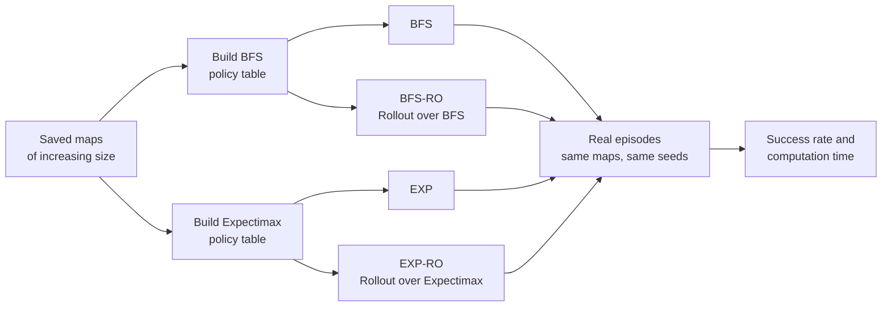
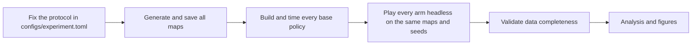

# Experimental Design

**Evaluating the Time-Performance Trade-off of BFS and Expectimax as Base Policies for Monte Carlo Rollout in Stochastic FrozenLake**

This document describes what the study measures, why, and how. It defines the decision problem, the algorithms being compared, the quantities to be estimated, and the protocol that keeps the comparison fair and reproducible. It is written to be read from top to bottom by someone who has not followed the project's planning discussions.

Every setting in this document has one of three statuses:

| Status | Meaning |
|---|---|
| **Fixed** | Part of the study design, including every experimental setting in `configs/experiment.toml`. Changing it changes the study. |
| **Open** | Not yet decided. It must be decided and recorded before the experiment runs. |

No result is reported here. All numbers in the worked examples are either computed from the definitions (marked *computed*) or invented to illustrate a formula (marked *illustrative*). None of them is an experimental finding.

---

## Contents

1. [Motivation and research question](#1-motivation-and-research-question)
2. [The decision problem](#2-the-decision-problem)
3. [Policies, values, and what "success" means](#3-policies-values-and-what-success-means)
4. [The two base policies](#4-the-two-base-policies)
5. [Monte Carlo Rollout](#5-monte-carlo-rollout)
6. [Experimental conditions and contrasts](#6-experimental-conditions-and-contrasts)
7. [Estimands: what exactly is being estimated](#7-estimands-what-exactly-is-being-estimated)
8. [Cost accounting and complexity](#8-cost-accounting-and-complexity)
9. [Measurements](#9-measurements)
10. [Experimental units, control, and reproducibility](#10-experimental-units-control-and-reproducibility)
11. [Statistical analysis plan](#11-statistical-analysis-plan)
12. [Research stages](#12-research-stages)
13. [Workload planning](#13-workload-planning)
14. [Threats to validity](#14-threats-to-validity)
15. [Scope of conclusions](#15-scope-of-conclusions)
16. [Decision register](#16-decision-register)

---

## 1. Motivation and research question

Many real decision problems share one difficulty: **actions do not have guaranteed outcomes**. A robot on a wet floor may slide sideways; a delivery may be delayed; a treatment may not work. An agent in such a world has to decide not only *where* it wants to go, but also *how much risk* it is willing to take on the way.

There are two broad ways to plan in such a world:

1. **Plan as if the world were deterministic, then react.** Compute the best route assuming every action works, and recompute the next move whenever something goes wrong. This is cheap, but it treats a safe route and a dangerous route of the same length as equally good.
2. **Reason explicitly about probabilities.** Weigh every possible outcome of every action by its probability. This captures risk, but the number of possible futures grows very quickly, and so does the cost.

**Rollout** is a third idea that sits between them. Before each real move, the agent *imagines* each possible action: it plays out many quick simulated futures that start with that action, letting a simple rule of thumb choose all later moves. It then makes the move whose simulated futures went best. A chess player who, before each move, mentally plays out a few quick games with a simple strategy is doing something similar. The rule of thumb is called the **base policy**. It is the engine of every simulation, so it determines both how informative the simulations are and how much they cost.

This creates a genuine design question. A **cheap** base policy, such as one that follows deterministic shortest paths, ignores the risk of slipping. A **sophisticated** base policy, such as depth-limited Expectimax, reasons explicitly about stochastic outcomes, but it is more expensive to build. Rollout's own sampling already exposes some of the risk the cheap policy ignores, because the simulated futures include the slips. It is therefore not obvious whether the sophisticated policy still adds value once Rollout is applied, or whether the cheap policy delivers comparable success for a fraction of the computation.

This study answers that question empirically, in a setting simple enough to control completely and rich enough to make the question non-trivial: the slippery FrozenLake.

> **Research question.** How does the choice of base policy (BFS or Expectimax) affect the trade-off between computational time and success rate in Monte Carlo Rollout across stochastic FrozenLake environments of increasing size?

> **Objective.** Evaluate whether the potential performance improvements provided by a more sophisticated base policy justify its additional computational cost.

The answer is expected to be a *description of a trade-off*, not a single winner. The study measures how much success the more sophisticated base policy adds, how much that difference costs, and how both vary with map size and simulation budget. Success and time remain separate dimensions: without a predefined utility function or cost limit, no single number can decide whether a gain is "worth it" (§7.5).

### 1.1 The study at a glance



1. **Maps.** Generate lakes of increasing size from fixed seeds and save them, so that every strategy faces exactly the same lakes.
2. **Policies.** For each map, build two complete policy tables, one with BFS and one with Expectimax, and time each build.
3. **Strategies.** Play real episodes with four strategies: each table used directly, and each table used as the base policy of the *same* Rollout procedure.
4. **Measurements.** Record, for every episode and every decision, whether the agent succeeded and how much computation it used.
5. **Comparison.** Estimate how much success Expectimax adds over BFS inside Rollout, how much that costs, and how both change with map size and the number of simulations.

### 1.2 Hypotheses

The hypotheses are questions to be tested, not expected results.

- **H1 (quality).** With equal rollout budgets, Rollout over Expectimax may reach higher success rates than Rollout over BFS on some maps, because its base policy accounts for transition risk.
- **H2 (cost).** Building the Expectimax policy requires more computation than building the BFS policy. Once both are stored as tables, looking up an action costs about the same.
- **H3 (sampling budget).** More rollout samples per action may improve value estimates at a higher decision cost. Episode success need not increase monotonically with the budget.
- **H4 (trade-off).** The simpler BFS base may give competitive success per unit of amortized computation, even where Expectimax improves absolute success.
- **H5 (scaling).** Map size, hole layout, horizon, and reward sparsity may substantially change the observed differences.

---

## 2. The decision problem

### 2.1 What FrozenLake is

FrozenLake is a classic benchmark environment distributed with [Gymnasium](https://gymnasium.farama.org/environments/toy_text/frozen_lake/), the standard Python library of decision-making environments maintained by the Farama Foundation (the successor of OpenAI Gym). Its story is simple: an agent must walk across a frozen lake from a start tile to a goal tile. Some tiles are holes in the ice, and falling into one ends the attempt. The ice is slippery, so the agent does not always move in the direction it chooses.

Despite its simplicity, FrozenLake contains the ingredients that make decision-making under uncertainty hard:
- **Uncertain outcomes:** the same action can lead to different places.
- **Irreversible failure:** a hole ends the episode; there is no recovering from a bad slip.
- **Sparse, delayed reward:** the agent learns nothing about success until it actually reaches the goal.
- **Scalable difficulty:** a single number, the grid size, controls how long the routes are and how expensive planning becomes.

It also suits this study for three methodological reasons:
1. **The dynamics are fully known and small.** Every possible transition and its exact probability can be read from the environment. The planners can therefore use the true model, and the study can verify that model against the reference implementation.
2. **There is a built-in gap between "a path exists" and "the agent is likely to arrive".** That gap is exactly what separates a shortest-path planner from a probabilistic one.
3. **It is a public, standard reference.** Anyone can reproduce the environment exactly.

FrozenLake is often used to study *reinforcement learning*, where the agent must learn from experience because it does not know the dynamics. This study is different: the dynamics are **known**, and nothing is learned. The question is how to **plan** with a known model, and at what computational price.

### 2.2 The lake

The environment is Gymnasium `FrozenLake-v1` (**Fixed**). A map is an $n \times n$ grid of tiles:

| Tile | Meaning | Effect of entering it |
|---|---|---|
| `S` | Start | Initial position |
| `F` | Frozen, safe | Continue |
| `H` | Hole | Episode ends in failure |
| `G` | Goal | Episode ends in success, reward 1 |

The agent's **state** is its tile, numbered row by row (row-major):

$$
s = r\,n + c, \qquad r = \left\lfloor s/n \right\rfloor, \qquad c = s \bmod n .
$$

The map layout never changes during an episode, so the position alone is a complete description of the situation.

The running example used throughout this document is the standard 4×4 map. Its states are numbered as follows:

```text
 map          state numbers
 S F F F       0  1  2  3
 F H F H       4  5  6  7
 F F F H       8  9 10 11
 H F F G      12 13 14 15
```

### 2.3 Slippery movement

The agent chooses an **intended** direction $a \in \mathcal{A} = \{\text{LEFT}, \text{DOWN}, \text{RIGHT}, \text{UP}\}$, encoded as 0, 1, 2, 3. The ice then decides where it actually goes (**Fixed**):

Let $a_{\perp,1}$ and $a_{\perp,2}$ denote the two directions perpendicular to $a$. Each perpendicular direction has probability $0.1$:

$$
\Pr(\text{move in direction } b \mid a) =
\begin{cases}
0.8, & b = a \quad \text{(intended)},\\
0.1, & b = a_{\perp,1},\\
0.1, & b = a_{\perp,2},\\
0, & b \text{ is opposite to } a .
\end{cases}
$$

The perpendicular directions rotate with the intended one. For RIGHT they are UP and DOWN; for UP they are LEFT and RIGHT. A move that would leave the grid leaves the agent where it is.

> **Naming note.** Gymnasium calls the 0.8 parameter `success_rate`. It is the probability that a *single move* goes as intended, and it has nothing to do with the study's main metric, the *episode* success rate (§7.1). This document calls it the **intended-move probability**.

**Example (computed).** In state 14 (bottom row, third column), choosing RIGHT gives:

| Actual direction | Probability | Next state | Why |
|---|---:|---:|---|
| RIGHT (intended) | 0.8 | 15 | Enters the goal |
| UP (slip) | 0.1 | 10 | Moves up one row |
| DOWN (slip) | 0.1 | 14 | Bottom border: the agent stays put |

At borders, two different directions can lead to the same state. In the top-left corner (state 0), choosing LEFT keeps the agent in place with probability $0.8 + 0.1 = 0.9$. The transition model keeps one record per direction, and the probability mass of records with the same destination adds up correctly.

### 2.4 The problem as a Markov Decision Process

Formally, the problem is a Markov Decision Process (MDP):

$$
\mathcal{M} = (\mathcal{S}, \mathcal{A}, P, R, \gamma),
$$

- $\mathcal{S}$: the $n^2$ tile states.
- $\mathcal{A}$: the four intended directions.
- $P(s' \mid s, a)$: the probability of reaching $s'$ after choosing $a$ in $s$, given by the slip rule above.
- $R(s, a, s')$: the immediate reward. It is $1$ when $s'$ is the goal and $0$ otherwise (**Fixed**).
- $\gamma$: the discount factor. It is $\gamma = 1$ (**Fixed**). With a finite episode, no discounting is needed.

Each possible outcome of an action is stored as a **transition record** $(p, s', r, t)$: its probability, next state, reward, and whether it ends the episode ($t$ = terminated). The planners and Rollout all read the same records, extracted once from Gymnasium and verified against it.

The reward is **sparse**: the agent receives no signal until it reaches the goal. Most decisions give no immediate evidence of whether they were good, and this is what makes planning necessary.

### 2.5 How an episode ends

A real episode ends in exactly one of three ways:

| Ending | Gymnasium flag | Recorded as | Success |
|---|---|---|---:|
| Enters the goal | `terminated` | `goal` | 1 |
| Enters a hole | `terminated` | `hole` | 0 |
| Reaches the step limit $T_{\max}$ | `truncated` | `timeout` | 0 |

Termination is part of the problem; truncation is an external time budget. A hole and a timeout are kept distinct: a policy that never falls but never arrives fails differently from one that takes reckless risks. If the goal is entered on the last allowed step, both flags are raised, and the episode counts as a **success**.

The step limit is the same for all strategies on a given map. It is set explicitly instead of relying on the `FrozenLake-v1` preset, which silently caps every map at 100 steps. The limit is $T_{\max} = 4n^2$ (**Fixed**).

### 2.6 A path is not a guarantee

A randomly generated map is accepted only if a hole-free path exists from `S` to `G` in the **deterministic** grid. That check says nothing about how likely an agent is to arrive under slipping. A map can have a short safe path that is very hard to follow because holes line its sides. This gap between deterministic reachability and stochastic success is exactly what separates the two base policies.

---

## 3. Policies, values, and what "success" means

### 3.1 A plan is not a policy

A **path** is a fixed sequence of moves, such as $0 \to 1 \to 2 \to \dots \to 15$. It assumes every move goes as intended. A **policy** is a rule that gives an action for every state:

$$
\pi : \mathcal{S} \to \mathcal{A}, \qquad \pi(s) = \text{action to take in } s .
$$

When the agent slips to an unexpected tile, it does not try to resume an old path. It looks up $\pi$ at the state it actually observes. Both base policies in this study are complete **policy tables**: one action for every nonterminal state, and no action for holes and the goal.

### 3.2 Value of a policy

The value of following $\pi$ from state $s$ is the expected total reward:

$$
V^{\pi}(s) = \mathbb{E}_{\pi}\!\left[\sum_{t=0}^{T-1} \gamma^{t} r_t \;\middle|\; s_0 = s\right],
$$

where $r_t$ is the reward received at step $t$ and $T$ is the step at which the episode ends. The expectation is over the random slips.

Because the only reward is $1$ for entering the goal and $\gamma = 1$, every episode returns either $1$ or $0$. The value is therefore a probability:

$$
V^{\pi}(s) = \Pr(\text{reach the goal before a hole or the time limit} \mid s_0 = s, \pi).
$$

This interpretation holds only for true values of this reward scheme. A heuristic score (§4.2) is not a probability, even when it lies between 0 and 1.

### 3.3 Value of trying an action once

The action value answers a counterfactual question: what happens if the agent takes action $a$ *now* and follows $\pi$ *afterwards*?

$$
Q^{\pi}(s, a) = \mathbb{E}\big[r_0 + \gamma\, V^{\pi}(s_1) \;\big|\; s_0 = s,\ a_0 = a\big].
$$

Rollout estimates exactly this quantity by simulation, then acts greedily:

$$
\pi_{\text{improved}}(s) = \arg\max_{a \in \mathcal{A}} Q^{\pi}(s, a).
$$

Here $\max$ returns a *value* and $\arg\max$ returns an *action*.

### 3.4 Planning versus acting

Planning evaluates hypothetical futures; acting commits one move in the real environment. Neither planner moves the real agent while it reasons, and no real move can be undone. In each real episode, the agent makes one decision per step and calls the environment exactly once per decision.

---

## 4. The two base policies

The two base policies were chosen because they sit at two ends of classical search:
- **BFS** is the textbook *deterministic graph search*. It is fast, simple, and optimal, but only for a world without slipping.
- **Expectimax** is the textbook *search under chance*. It models every slip explicitly, but only a limited number of moves ahead, and at a much higher cost.

Both produce the **same kind of object**: a table with one action for each state. Swapping one table for the other inside Rollout changes nothing else, so any difference in results is attributable to the base policy.

Both base policies are **precomputed once per map** and stored as tables (**Fixed**). During an episode, and inside every Rollout simulation, the next action is a table lookup costing $O(1)$. No planner is re-run during simulations.

### 4.1 BFS: shortest deterministic paths

**The idea.** Breadth-first search (BFS) explores a graph in *layers*, like ripples spreading from a stone dropped in water. First it finds everything one step away, then everything two steps away, and so on. A first-in, first-out (FIFO) queue keeps this order. Because of the layer order, the first time BFS reaches a node, it has reached it by a shortest path. In a graph where every edge costs the same, BFS therefore finds minimum-length paths.

**Turning the lake into a graph.** To apply BFS, the lake is simplified into a *deterministic abstraction*:
- every non-hole tile becomes a node;
- two nodes are connected if the tiles are horizontal or vertical neighbors;
- holes are removed from the graph;
- every move costs one step, and **slipping is ignored**.

BFS answers the question "how many moves does the shortest safe route take?" in this simplified world. It cannot ask "how likely am I to survive that route?", because the abstraction has no probabilities.

**How BFS is used here.** The study does not use BFS to find *one* path from the start, because a single path is useless as soon as the agent slips off it. It uses BFS to compute the distance from *every* tile to the goal, and turns those distances into a policy that covers every tile the agent might slip onto.

**Reverse BFS.** Instead of searching from every state to the goal, a single BFS runs *from the goal* and computes the distance $d_{\text{BFS}}(s, G)$ of every state at once. Because the grid's connections are symmetric, distances to the goal equal distances from the goal.

1. Set $d(G) = 0$ and $d(s) = \infty$ for every other state; put $G$ in a FIFO queue.
2. Remove the front state $u$ from the queue.
3. For each non-hole neighbor $v$ of $u$ not yet reached, set $d(v) = d(u) + 1$ and add $v$ to the queue.
4. Repeat until the queue is empty. States never reached keep $d = \infty$.

**From distances to a policy.** In every nonterminal state, the BFS policy chooses an intended move toward a neighbor with the smallest distance:

$$
\pi_{\text{BFS}}(s) \in \arg\min_{a} \; d_{\text{BFS}}\big(T_{\text{det}}(s, a), G\big),
$$

where $T_{\text{det}}(s, a)$ is the tile the move would reach without slipping. Moves into holes and moves that bump into a border are never preferred over a shorter route. Ties are broken by the fixed action priority RIGHT, DOWN, LEFT, UP (**Fixed**). A nonterminal state with no route to the goal receives a deterministic fallback: the first action in that priority whose target is not a hole (bumping into a border counts as safe), or the first action if every move leads into a hole. The fallback is not a good decision, since no action reaches the goal from such a state; it only avoids walking into a hole on purpose. How often it is used is recorded.

**Example (computed).** Reverse BFS distances on the running 4×4 map:

```text
 6  5  4  5
 5  H  3  H
 4  3  2  H
 H  2  1  0
```

Read as ripples from the goal, the layers are: distance 0 is $\{15\}$, 1 is $\{14\}$, 2 is $\{10, 13\}$, 3 is $\{6, 9\}$, 4 is $\{2, 8\}$, 5 is $\{1, 3, 4\}$, and 6 is $\{0\}$, the start.

From state 6 (distance 3), the shortest-path neighbor is state 10 (distance 2), so $\pi_{\text{BFS}}(6) = \text{DOWN}$. As §4.3 shows, this move carries a 20% chance of falling into a hole, a risk that BFS never considers.

**What BFS gets right and wrong.**
- *Right:* it is optimal in the world without slipping, very cheap to build, and, as a complete table, it gives a sensible action from any tile the agent slips onto.
- *Wrong:* it gives the same value to a route along the open ice and a route between two holes, if they have the same length. It is **risk-blind** by construction.

This makes BFS the natural *cheap baseline*: the strongest policy that can be built without looking at the probabilities.

**Cost.** BFS visits each traversable state once and checks at most four neighbors, so building the distances takes $O(V + E) = O(n^2)$ time and $O(n^2)$ memory.

### 4.2 Depth-limited Expectimax: reasoning about outcomes

**The idea.** Expectimax comes from game-tree search. In a two-player game such as chess, *Minimax* looks ahead by alternating the player's moves (who picks the best option) and the opponent's moves (who picks the worst option for the player). In FrozenLake there is no opponent, only the ice, which is random but not hostile. Expectimax replaces the opponent with **chance**: instead of assuming the worst outcome, it averages the outcomes, weighted by their probabilities. The look-ahead tree alternates two kinds of nodes:

- **MAX nodes:** the agent chooses the action with the highest value.
- **CHANCE nodes:** the environment's outcomes are averaged, weighted by their probabilities.

One level of the tree for state 6 of the running example looks like this:

```text
                                MAX: state 6, pick the best action
         ┌───────────────────┬─────────┴─────────┬───────────────────┐
       LEFT                DOWN                RIGHT                 UP
      CHANCE              CHANCE               CHANCE              CHANCE
   0.1  0.8  0.1       0.1  0.8  0.1        0.1  0.8  0.1       0.1  0.8  0.1
    │    │    │         │    │    │          │    │    │          │    │    │
    2    5H   10        5H   10   7H         10   7H   2           7H   2    5H
```

Each leaf is the tile reached by one outcome. Holes (`H`) end the branch with value 0. Every other leaf is either expanded further, with a new MAX node asking "what would I do if I landed here?", or scored by a heuristic when the look-ahead depth runs out.

**Why the depth must be limited.** Each level multiplies the tree by up to $A \times C = 4 \times 3 = 12$ branches. Six levels already give $12^6 \approx 3$ million leaves for a *single* starting state. Two ideas keep this affordable:
1. **Memoization.** Different branches often reach the same tile with the same depth left. Caching the value of each $(s, d)$ pair means it is computed once. A 4×4 map searched to depth 6 has at most $16 \times 7 = 112$ such pairs (depths 0 to 6), instead of millions of leaves.
2. **A depth limit with a heuristic.** The search stops after $D$ moves and scores the frontier with an estimate of progress (below), instead of searching until every branch ends.

**How Expectimax is used here.** Like BFS, it is turned into a complete table: the best action is computed for **every** nonterminal state, before any episode starts.

**The recursion.** Let $D$ be the search depth, $d$ the *remaining* depth during the recursion, and $h$ the leaf heuristic. The values are defined recursively:

$$
V_0(s) = h(s) \qquad \text{for a nonterminal state at the depth limit,}
$$

$$
Q_d(s, a) = \sum_{(p,\, s',\, r,\, t) \,\in\, P(s, a)} p \,\Big( r + \mathbf{1}[\neg t]\; \gamma\, V_{d-1}(s') \Big),
$$

$$
V_d(s) = \max_{a \in \mathcal{A}} Q_d(s, a), \qquad \pi_{\text{EXP}, D}(s) = \arg\max_{a} Q_D(s, a).
$$

Reading the CHANCE equation term by term:
- the sum runs over the transition records of action $a$ in state $s$;
- each outcome contributes its immediate reward $r$ plus the value of continuing from $s'$;
- the indicator $\mathbf{1}[\neg t]$ is zero when the outcome ends the episode, so holes and the goal have **no continuation value**;
- the goal's reward of 1 is therefore counted **once**, on entry.

Search depth $D = 6$ is **Fixed**. The policy is computed for **every** nonterminal state before any episode starts. Values are memoized by $(s, d)$: the depth must be part of the cache key, because $V_3(s)$ and $V_5(s)$ generally differ.

**The leaf heuristic (Fixed family).** When the depth runs out in a nonterminal state, Expectimax scores the state by its BFS distance to the goal:

$$
h_\beta(s) =
\begin{cases}
\beta^{\,d_{\text{BFS}}(s, G)}, & s \text{ nonterminal with finite distance},\\
0, & s \text{ terminal or unreachable},
\end{cases}
\qquad 0 < \beta < 1 .
$$

Closer states score higher. With $\beta = 0.90$ (**Fixed**), one step costs 10% of the score: $h = 0.9$ at distance 1, $0.81$ at distance 2, $0.729$ at distance 3. The heuristic is a **progress score, not a probability of success**. Two consequences are disclosed explicitly:
1. Expectimax is not independent of BFS: it uses BFS distances at its search frontier.
2. Its build cost must include computing those distances (§8.1).

**What Expectimax gets right and wrong.**
- *Right:* within its look-ahead, it weighs every slip by its true probability, so it can prefer a slightly longer route that stays away from holes.
- *Wrong:* beyond its depth it knows only the BFS distance, which is risk-blind again. It is not an optimal stochastic policy, and it costs more to build than BFS.

This makes Expectimax the natural *sophisticated* candidate: risk-aware, but at a price that grows with depth and map size. The study measures whether that price buys anything once Rollout is added.

### 4.3 Worked example: one step of Expectimax

The tables below compute $Q_1$ on the running 4×4 map with $\beta = 0.9$ and $\gamma = 1$ (*computed*). Each cell lists the probability, the next state, and the next state's tile.

**State 14, next to the goal.** All four actions are reasonable, and MAX must rank them:

| Action | Outcomes $(p \to s')$ | $Q_1(14, a)$ |
|---|---|---:|
| LEFT | $0.1 \to 10$, $0.8 \to 13$, $0.1 \to 14$ | 0.819 |
| DOWN | $0.1 \to 13$, $0.8 \to 14$ (border), $0.1 \to 15$ (G) | 0.901 |
| **RIGHT** | $0.1 \to 14$ (border), $0.8 \to 15$ (G), $0.1 \to 10$ | **0.971** |
| UP | $0.1 \to 15$ (G), $0.8 \to 10$, $0.1 \to 13$ | 0.829 |

For RIGHT: $0.8 \times 1 + 0.1 \times h(14) + 0.1 \times h(10) = 0.8 + 0.1 \times 0.9 + 0.1 \times 0.81 = 0.971$. The goal contributes its reward of 1 and nothing more.

**State 6, between two holes.** This is where risk appears:

| Action | Outcomes $(p \to s')$ | $Q_1(6, a)$ |
|---|---|---:|
| LEFT | $0.1 \to 2$, $0.8 \to 5$ (H), $0.1 \to 10$ | 0.147 |
| **DOWN** | $0.1 \to 5$ (H), $0.8 \to 10$, $0.1 \to 7$ (H) | **0.648** |
| RIGHT | $0.1 \to 10$, $0.8 \to 7$ (H), $0.1 \to 2$ | 0.147 |
| UP | $0.1 \to 7$ (H), $0.8 \to 2$, $0.1 \to 5$ (H) | 0.525 |

Every action in state 6 has at least a 20% chance of ending in a hole. Expectimax quantifies that risk in the CHANCE average. BFS picks DOWN for its distance alone. Here the one-step Expectimax ranking also puts DOWN first, but for a different reason: it is the least risky way to make progress. Where the risk-aware and the distance-only choices differ, H1 can show up.

These are one-step values. With $D = 6$, the values $0.81$, $0.9$, … at the leaves are replaced by the results of deeper MAX/CHANCE subtrees, and the heuristic is only used where depth runs out.

### 4.4 Why $\beta$ matters

$\beta$ sets how strongly distance is penalized, so it can change which action wins. **Toy example (illustrative, not FrozenLake probabilities):** action A survives with probability 0.9 and lands at distance 3; action B survives with probability 0.8 and lands at distance 1.

$$
Q_A = 0.9\,\beta^{3}, \qquad Q_B = 0.8\,\beta .
$$

| $\beta$ | $Q_A$ | $Q_B$ | Preferred |
|---:|---:|---:|---|
| 0.90 | 0.656 | 0.720 | B (closer, riskier) |
| 0.95 | 0.772 | 0.760 | A (farther, safer) |

Because $\beta$ steers Expectimax's behavior, it is part of the Expectimax design. It is chosen *before* the experiment runs and never tuned afterwards to make one strategy win (§12.1).

### 4.5 Depth versus distance

Without slipping, a state at BFS distance $d$ needs at least $d$ moves to reach the goal, and slipping cannot shorten this. In the running example the start has distance 6, so with $D = 6$ Expectimax can just see the goal from the start, but only along the shortest path. On larger maps, most states are farther than $D$ from the goal, and their values come mostly from the heuristic. Whether $D = 6$ leaves enough planning signal on the larger maps is something the results will show; the depth is not changed after seeing them.

---

## 5. Monte Carlo Rollout

### 5.1 The idea

Rollout improves a base policy $\pi_0$ one decision at a time. At each real state $s$, it estimates $Q^{\pi_0}(s, a)$ for each of the four actions **by simulation**:

1. For each candidate action $a$, run $N$ independent simulated trajectories.
2. In each trajectory, take $a$ first, sample its outcome from the transition model, and then follow $\pi_0$, looking up the table at every simulated state.
3. Stop the trajectory at a hole, at the goal, or at the simulation horizon.
4. Average the returns of the $N$ trajectories of each action.
5. Take the action with the highest average **in the real environment**, once.

The same Rollout implementation serves both base policies (**Fixed**): it receives a policy table and does not know which planner produced it. The two Rollout strategies differ *only* in the table they receive.

### 5.2 The estimator

$$
\widehat{Q}_{N,H}^{\pi_0}(s, a) = \frac{1}{N} \sum_{i=1}^{N} \sum_{t=0}^{H-1} \gamma^{t}\, r_t^{(i)},
\qquad
\pi_{\text{RO}}(s) = \arg\max_{a} \widehat{Q}_{N,H}^{\pi_0}(s, a),
$$

- the hat marks an *estimate*;
- $i$ indexes trajectories and $t$ simulated steps;
- $N$ is the number of trajectories **per candidate action**, so one decision runs $4N$ trajectories;
- $H$ is the simulation horizon, not the Expectimax depth.

When the real episode has fewer steps left than $H$, simulations respect what remains: $H_{\text{eff}} = \min(H, \text{remaining real steps})$. The horizon is $H = 2n^2$ (**Fixed**). Rollout strategies require $N \ge 1$. The strategies without Rollout are separate conditions, not "$N = 0$".

### 5.3 Tie-breaking

With sparse rewards, several actions often have the same estimate. A common case is all zeros, when no trajectory reached the goal. Picking the first action in enumeration order would add an arbitrary bias. The rule is (**Fixed**):
1. find the maximal estimate;
2. if the base policy's action is among the maximizers, choose it;
3. otherwise choose the first maximizer in the fixed action priority RIGHT, DOWN, LEFT, UP. Estimates closer than $10^{-12}$ count as equal (**Fixed**); with returns of 0 or 1 they are multiples of $1/N$, so this only absorbs rounding.

This makes Rollout fall back to its base policy when simulations carry no information.

### 5.4 How precise is one estimate?

Each trajectory returns 1 (reached the goal) or 0, so $\widehat{Q}$ is the mean of $N$ Bernoulli draws with mean $Q$. Its standard error is:

$$
\text{SE}\big(\widehat{Q}\big) = \sqrt{\frac{Q\,(1 - Q)}{N}} .
$$

At the worst case $Q = 0.5$ (*computed*):

| $N$ | 10 | 25 | 50 | 100 |
|---|---:|---:|---:|---:|
| $\text{SE}(\widehat{Q})$ | 0.158 | 0.100 | 0.071 | 0.050 |

With $N = 10$, two actions whose true values differ by 0.1 are frequently ranked in the wrong order. Quadrupling $N$ only halves the error. This is the mechanism behind H3: more samples buy precision at a linear cost, with diminishing returns.

### 5.5 Example: why Rollout can overrule its base policy (illustrative)

Suppose BFS recommends RIGHT because it lies on the shortest path, but RIGHT passes next to a hole. Rollout with $N = 100$ might observe:

- RIGHT, then BFS: 62 of 100 trajectories reach the goal, so $\widehat{Q} = 0.62$;
- UP, then BFS: 84 of 100 trajectories reach the goal, so $\widehat{Q} = 0.84$.

Rollout plays UP, even though every later simulated move followed BFS. These numbers are invented; they show why `BFS` and `BFS-RO` can decide differently.

### 5.6 What Rollout does not guarantee

With exact values, one step of greedy improvement never makes a policy worse. With finite samples and a finite horizon, the estimates are noisy and truncated, and Rollout can occasionally pick a worse action. The study therefore never assumes that `BFS-RO` beats `BFS` or that `EXP-RO` beats `EXP`. These are measured.

### 5.7 The exact reference (N = ∞)

Because the transition model is known, the quantity Rollout estimates can also be computed exactly. With the base policy fixed, its finite-horizon value follows by dynamic programming:

$$
V_0(s) = 0, \qquad V_h(s) = \sum_{(p,\, s',\, r,\, t)\, \in\, P(s, \pi_0(s))} p\,\big(r + \mathbf{1}[\neg t]\,\gamma\,V_{h-1}(s')\big),
$$

and the exact value of trying action $a$ first is $Q_h(s,a) = \sum_{(p,s',r,t) \in P(s,a)} p\,\big(r + \mathbf{1}[\neg t]\,\gamma\,V_{h-1}(s')\big)$. The table $V_h(s)$ is computed once per map, for every horizon up to $H$, so each decision is a lookup.

The experiment also plays an **exact reference** for each Rollout strategy (**Fixed**): the same Rollout, with the same horizon cap and tie rule, but with exact values in place of sampled estimates. It samples nothing, so it shows where Rollout over that base policy ends up as $N$ grows: the ceiling that the sampled strategies approach. It is reported as a reference line for success only. Its time is not a cost to compare: it simulates nothing, and its value table is computed when it is set up.

---

## 6. Experimental conditions and contrasts

### 6.1 Four strategies

The design crosses base policy (BFS or Expectimax) with Rollout (off or on) (**Fixed**):

| | Rollout off | Rollout on |
|---|---|---|
| **BFS base** | `BFS`: follow $\pi_{\text{BFS}}$ | `BFS-RO`: Rollout over $\pi_{\text{BFS}}$ |
| **Expectimax base** | `EXP`: follow $\pi_{\text{EXP}}$ | `EXP-RO`: Rollout over $\pi_{\text{EXP}}$ |

The strategies without Rollout are essential baselines. Without them, a difference between `EXP-RO` and `BFS-RO` could not be split into "Expectimax is a better policy" and "Rollout improves the two policies by different amounts".

### 6.2 Planned contrasts

1. **Primary:** `EXP-RO` versus `BFS-RO`, at equal map, episode conditions, and rollout budget $N$.
2. **Secondary:** `BFS-RO` versus `BFS`, and `EXP-RO` versus `EXP`. These measure what Rollout adds to each base policy.
3. **Reference:** `EXP` versus `BFS`. This compares the base policies alone.

### 6.3 What "paired" means

Within a comparison, the following are identical: the map, the transition probabilities, the rewards, the step limit, the rollout settings, and the episode identifiers with their seeds. The *trajectories* are not identical. Once two policies choose different actions, they visit different states. The fairness standard is identical **starting conditions and randomization protocol**, not identical paths.

### 6.4 One real decision, four ways

Suppose the agent stands on state 6 of the running example, between two holes, during a real episode. This is what each strategy does before the single real move. The steps are exact; the quantities are not results.

| Strategy | What happens before the move | Work at this decision |
|---|---|---|
| `BFS` | Look up $\pi_{\text{BFS}}(6)$ = DOWN in the table. | One lookup |
| `EXP` | Look up $\pi_{\text{EXP}}(6)$ in the table built before the episode. | One lookup |
| `BFS-RO` | For each of the 4 actions, simulate $N$ futures: take the action, sample the slip, then follow $\pi_{\text{BFS}}$ until a hole, the goal, or the horizon. Average each action's returns, pick the best, and prefer DOWN on ties. | $4N$ trajectories |
| `EXP-RO` | Exactly the same procedure, following $\pi_{\text{EXP}}$ inside the simulations, and preferring $\pi_{\text{EXP}}(6)$ on ties. | $4N$ trajectories |

Then every strategy does the same thing: it sends **one** intended action to the real environment. The ice decides the outcome, and the agent observes where it actually landed. With DOWN, it lands on 10 with probability 0.8 and falls into hole 5 or 7 with probability 0.1 each. The next decision starts from the observed tile.

The table shows where the costs come from. The two base-only strategies paid their whole planning cost before the episode, when their tables were built. The two Rollout strategies pay a large cost at *every* decision. Per simulated step that cost is the same for both, because simulations only perform table lookups and samples; the total still depends on how long the imagined futures last before ending in a hole or at the goal. The difference between `BFS-RO` and `EXP-RO` lies elsewhere: in the quality of the futures they imagine, and in the one-time cost of building the Expectimax table.

---

## 7. Estimands: what exactly is being estimated

An **estimand** is the quantity the study intends to estimate, defined before any data exist. Defining it first prevents the analysis from drifting toward whatever comparison looks best afterwards.

### 7.1 Success rate

For strategy $k$ on map $m$ with budget $N$, the episode success probability is:

$$
p_{k}(m, N) = \Pr\big(\text{episode reaches the goal} \mid \text{strategy } k,\ \text{map } m,\ N\big).
$$

It is estimated from $E$ episodes as:

$$
\hat{p}_{k}(m, N) = \frac{\text{episodes reaching the goal}}{E}.
$$

For the strategies without Rollout, $N$ does not apply.

### 7.2 Primary success contrast

Maps of size $n$ are drawn from a generator (§10.1). The primary success estimand averages over that population of maps:

$$
\Delta_S(n, N) = \mathbb{E}_{m \sim \mathcal{G}_n}\big[\, p_{\text{EXP-RO}}(m, N) - p_{\text{BFS-RO}}(m, N) \,\big],
$$

where $\mathcal{G}_n$ is the map distribution for size $n$. Positive values mean Rollout over Expectimax succeeded more often. The secondary and reference contrasts are defined the same way with the corresponding pairs of strategies.

### 7.3 Amortized computation time

A policy is built once and reused across episodes. The fair cost per episode spreads the build over those episodes:

$$
T_{\text{amortized}} = \frac{T_{\text{build}}}{R} + \overline{T}_{\text{episode}},
$$

- $T_{\text{build}}$: time to construct the base policy for the map, **including all required preprocessing**.
- $R$: the number of real episodes that reuse that build.
- $\overline{T}_{\text{episode}}$: mean agent computation per episode, the sum of measured decision times.

For the strategies without Rollout, each decision is a table lookup and $\overline{T}_{\text{episode}}$ is close to zero. For the Rollout strategies, it is dominated by simulation.

**Example (illustrative arithmetic).** If building $\pi_{\text{EXP}}$ took 40 ms and the policy served $R = 20$ episodes whose decisions cost 150 ms each on average, then $T_{\text{amortized}} = 40/20 + 150 = 152$ ms per episode. With $R = 2$, the same build would add 20 ms instead of 2. The value of $R$ changes the answer, so it is declared with every amortized result.

**Convention (Fixed).** The experiment records build times and per-episode decision times as separate raw measurements; no $R$ is built into the data. The analysis uses $R = E$, the number of episodes each strategy plays on a map, as the primary amortization, and also shows how the comparison changes as $R$ varies.

The paired cost contrast mirrors the success contrast:

$$
\Delta_T(n, N) = \mathbb{E}_{m}\big[\, T_{\text{amortized}}^{\text{EXP-RO}}(m, N) - T_{\text{amortized}}^{\text{BFS-RO}}(m, N) \,\big].
$$

### 7.4 Why both dimensions are needed

A weak policy that falls into a hole early spends little time computing. Ranking strategies by time alone would reward early failure. Ranking by success alone would ignore cost. The primary result is therefore the **pair** $(T_{\text{amortized}}, \text{success rate})$ for each strategy and budget, shown on two axes (**Fixed**).

### 7.5 Reading the trade-off: Pareto dominance

Configuration $x$ **dominates** $y$ if $x$ is at least as fast and at least as successful, and strictly better in at least one of the two. The configurations that no other configuration dominates form the **observed Pareto frontier**. If `EXP-RO` is more successful but slower than `BFS-RO`, neither dominates. Deciding between them then requires a preference: a cost limit, a minimum success target, or a utility function. None is imposed by this study; the frontier is reported so that each reader can apply their own. Proximity to the frontier is not statistical significance, and uncertainty is reported alongside (§11).

---

## 8. Cost accounting and complexity

### 8.1 Three costs, measured separately

| Cost | When it is paid | What it includes |
|---|---|---|
| **Policy build** | Once per map and configuration | BFS: distances and action extraction. Expectimax: BFS distances for the heuristic, the memoized recursion, and action extraction |
| **Decision** | Each real step | Base-only strategies: a table lookup. Rollout strategies: $4N$ simulated trajectories |
| **Episode wall time** | Each real episode | The whole headless episode, reported separately from agent computation |

Each strategy is charged its **standalone** cost (**Fixed**). Expectimax is charged for the BFS distances it needs, even if an implementation shares the distance table with the BFS policy for convenience. Otherwise Expectimax would hide part of its cost.

A complementary measure, **paired-state decision time**, times each Rollout strategy on the *same* prespecified set of states. It isolates the cost per decision from the length of the episodes in which those decisions happen.

### 8.2 Complexity

| Procedure | Time | Memory | Paid |
|---|---|---|---|
| Reverse BFS + policy | $O(V + E) = O(n^2)$ | $O(n^2)$ | Once per map |
| Expectimax without memoization | up to $O((A\,C)^D)$ | $O(D)$ stack | Not used |
| Memoized Expectimax policy | $O(V \cdot D \cdot A \cdot C)$ + BFS | $O(V \cdot D)$ cache | Once per map, depth, and $\beta$ |
| Policy lookup | $O(1)$ | in the table | Every real or simulated step |
| One Rollout decision | $O(A \cdot N \cdot H)$ worst case | $O(A)$ | Every real step |
| One Rollout episode | $O(K \cdot A \cdot N \cdot H)$ worst case | $O(A)$ | Every real episode |

Here $V \le n^2$ is the number of states, $E$ the number of grid connections, $A = 4$ actions, $C \le 3$ outcomes per action, and $K$ the number of real decisions in the episode.

**Example (computed upper bound).** With $N = 100$ and $H = 50$, one decision may simulate up to $4 \times 100 \times 50 = 20{,}000$ transitions, and an episode of $K = 30$ decisions up to $600{,}000$. These are 600,000 *table lookups and samples*, not 600,000 planner runs. In practice, simulations stop early at holes and at the goal, so actual counts are much lower and are measured directly (§9).

Asymptotic bounds are not timings. All reported times come from measurements under the protocol in §10.4.

---

## 9. Measurements

| Level | Quantity | Unit |
|---|---|---|
| Episode | success (0/1), termination reason (`goal`/`hole`/`timeout`), real steps, total reward | — |
| Episode | agent computation time; headless wall time | ns |
| Episode | simulated transitions | count |
| Decision | decision time; simulated transitions; trajectories evaluated | ns, count |
| Decision | base-policy action, chosen action, per-action estimates $\widehat{Q}$ | — |
| Policy build | build time (repeated fresh builds) | ns |
| Policy build | BFS: visited states, neighbor checks, peak queue length | count |
| Policy build | Expectimax: computed $(s, d)$ subproblems, outcomes examined, cache hits, cache entries, peak recursion depth | count |

BFS's queue and Expectimax's recursion stack and cache measure **different things**. They are never plotted as one "frontier size". If memory is ever compared directly, a separate profiling run measures both in bytes.

Times are recorded in nanoseconds with a monotonic high-resolution clock and converted to milliseconds for reporting. Missing values are blank only where a quantity does not apply, for example $N$ for base-only strategies, and never silently become zero.

---

## 10. Experimental units, control, and reproducibility

### 10.1 Maps

Maps are generated **before** any strategy runs, from explicit seeds. Each tile is frozen with probability $q = 0.90$ (**Fixed**), with `S` top-left and `G` bottom-right, and a map is redrawn until a deterministic path exists. The exact layout of every map is saved together with its seed, size, and $q$, and all four strategies run on the saved layout. A map is never regenerated between strategies.

The **map is the unit of environmental variation**. Several episodes on one map are repeated measurements of that map, not independent maps. Conclusions about "maps of size $n$" therefore need several maps per size.

### 10.2 Episodes and random streams

Three independent random streams are kept separate (**Fixed**):

| Stream | Decides | Consumed by |
|---|---|---|
| Map generation | Tile layouts | Map creation only |
| Real environment | Real slips | Real steps only, seeded at episode reset |
| Simulation | Hypothetical slips | Rollout only |

Separation matters for fairness. If Rollout drew from the real environment's stream, every simulation would shift which slips happen in the real episode. The same episode seed would then mean different real conditions for `BFS` and `BFS-RO`, and changing $N$ would change the agent's "luck". With separate streams, the same episode identifiers give every strategy the same real starting conditions.

### 10.3 Seed derivation

Every seed is derived deterministically from a canonical description of its role, for example:

```text
v1 / master_seed / map / size / map_index
v1 / master_seed / episode / size / map_index / episode_index
v1 / master_seed / rollout / size / map_index / episode_index / strategy / N
```

The seed is the first 8 bytes of the SHA-256 hash of that string, shifted to 63 bits (**Fixed**), never Python's per-process salted `hash()`. Every arm of an episode uses the same episode seed; each sampled Rollout arm has its own simulation seed, so changing $N$ never changes the real slips. Derived seeds and the scheme version (`v1`) are saved with the results.

### 10.4 Measurement hygiene

- Runs are headless: no rendering, animation, or progress output inside timed sections.
- Policy build, decision, and episode times are separate measurements.
- Each base policy is built 30 times per map, from scratch, after one untimed warm-up build; every repeat is recorded and summaries use the median (**Fixed**).
- The experiment runs sequentially, in one process, on one machine, whose hardware and software are recorded (**Open**: the machine).
- No correction for "interpreter overhead" is applied after the fact.

Maps, seeds, decisions, and outcomes are expected to reproduce exactly. Timings are not expected to reproduce across machines or system load.

---

## 11. Statistical analysis plan

### 11.1 From episodes to maps to sizes

1. For each map $m$, strategy $k$, and budget $N$: estimate $\hat{p}_k(m, N)$ from its $E$ episodes.
2. For each map: compute the paired difference $\hat{D}_m = \hat{p}_{\text{EXP-RO}}(m, N) - \hat{p}_{\text{BFS-RO}}(m, N)$.
3. For each size $n$: estimate $\Delta_S(n, N)$ by the mean of $\hat{D}_m$ over the $M$ maps of that size.

Results are reported **per map size**. Sizes differ in difficulty, and a single global average would mix them.

### 11.2 Uncertainty

Uncertainty must respect the two levels of variation: episodes within a map, and maps within a size. The planned approach is a **cluster bootstrap**, computed in the analysis from the raw data, not by the experiment runner (**Open**: final procedure and number of resamples):
1. resample maps with replacement;
2. resample episodes within each selected map;
3. recompute the estimate;
4. repeat, and report percentile intervals.

**Example (computed).** The standard error of a single map's success rate from $E$ episodes is $\sqrt{p(1-p)/E}$. At $p = 0.5$, it is $0.112$ for $E = 20$ and $0.091$ for $E = 30$. A one-map difference of a few percentage points is therefore well within noise. With only five maps per size, intervals are approximate, and the report describes them as such.

### 11.3 Timing summaries

Decision times are skewed: a few long decisions occur when trajectories survive long. Medians and spread (for example interquartile ranges) are reported along with means. Build and online costs are reported separately before they are combined into amortized cost.

### 11.4 Planned figures

| Figure | Shows | Answers |
|---|---|---|
| **A (primary)** | Success rate vs amortized time per episode, per size; one point per strategy and $N$ | The research question |
| B | Success rate vs $N$ (log scale), with base-only strategies and the exact reference as horizontal lines | H1, H3 |
| C | Decision time and simulated transitions vs $N$ | H3, cost mechanism |
| D | Policy build time vs map size | H2 |
| E | Search work vs map size, per algorithm and counter | H2, H5 |
| F | Algorithm-specific memory diagnostics (queue, stack, cache) | H2 |
| G (optional) | Paired-state decision time | Cost without the episode-length confound |

All figures are generated from the saved raw data, never by re-running agents.

---

## 12. Research stages



### 12.1 Fix the protocol before running

There is a single experiment, described by `configs/experiment.toml`. Every setting in it is chosen and recorded here **before** the experiment runs, with the reasons for each value, so that no value can be fitted to the results:

| Setting | Value | Why |
|---|---|---|
| Map sizes $n$ | 4, 6, 8, 10, 12 | Increasing size is the study's main axis; 12×12 keeps the whole run within about half an hour |
| Maps per size | 5 | Map-level variation; the map is the unit of environmental variation |
| Episodes per map and arm | 30 | Precision of each map's success rate (§11.2) |
| Rollout budgets $N$ | 10, 25, 50, 100, 200, 400, 800 | Log-spaced, so the results can show both the noisy low-$N$ regime and the high-$N$ regime |
| Exact reference | On | The $N = \infty$ ceiling for each Rollout strategy (§5.7) |
| Expectimax depth $D$ | 6 | Look-ahead within reach of the goal on small maps, affordable on large ones |
| $\beta$ | 0.90 | Starting value of the heuristic family; not tuned afterwards |
| Discount $\gamma$ | 1 | Episodes are finite; every success counts fully |
| Frozen-tile probability $q$ | 0.90 | About 10% holes |
| Step limit $T_{\max}$ | $4n^2$ | Identical for all strategies |
| Rollout horizon $H$ | $\min(2n^2, \text{remaining steps})$ | Long enough to reach the goal, finite runtime |
| Policy builds | 30 timed per map, after 1 warm-up | Stable build-time medians |
| Master seed | 2026 | Every map, episode and simulation seed derives from it (§10.3) |

### 12.2 Run and validate

`frozen-lake benchmark --config configs/experiment.toml` generates and saves every map, builds and times every base policy, and plays every arm on the same maps and episode seeds, headless and with no parameter changes during the run. The results go to a new folder named after the start time and the configuration hash; an existing folder is never overwritten. Before anything is analyzed, the written data are validated:
- every map, episode and arm is present, and no row is duplicated;
- every arm of an episode shares the same episode seed;
- every episode's decisions add up to its steps;
- the saved maps match their seeds.

### 12.3 Changing the protocol

If a setting changes after results have been seen (for example, if one size gives no variation in success for any strategy), that is a **new protocol version**: it is recorded here with its reason and run as a new experiment, in its own results folder. Earlier results are kept, never overwritten, and results from different protocol versions are never mixed.

---

## 13. Workload planning

The strategies without Rollout do not depend on $N$, so they run once per map and episode, not once per budget. With $S$ sizes, $M$ maps per size, $E$ episodes, $L$ rollout budgets and the two exact references, the number of real episodes is:

$$
S \times M \times E \times (2 + 2L + 2) = 5 \times 5 \times 30 \times 18 = 13{,}500.
$$

Each Rollout episode contains thousands to hundreds of thousands of simulated transitions (§8.2), so the number of simulated transitions predicts total cost better than the episode count. Measured before fixing the protocol, the largest maps dominate: on a 12×12 lake, one episode of each sampled budget from $N = 10$ to $N = 800$ takes about 4 s in total per Rollout strategy. The whole experiment is expected to take about half an hour on the development machine; `frozen-lake benchmark --dry-run` prints the exact matrix before running.

---

## 14. Threats to validity

| Threat | Why it matters | Mitigation |
|---|---|---|
| Heuristic read as a probability | Misleading interpretation of Expectimax values | $h$ is labeled a progress score; $\widehat{Q}$ is labeled a sampled estimate; neither is the measured success rate |
| Expectimax depends on BFS distances | The two base policies are not independent methods | Disclosed; BFS preprocessing is charged to Expectimax's build cost |
| $\beta$ or $D$ tuned to favor a strategy | Biased comparison | Values fixed and justified before running (§12.1) |
| Early failure looks cheap | Confounds cost with failure | Success and amortized cost are reported together; paired-state decision time is added |
| Simulation differs from Gymnasium | Invalidates every result | The transition model is verified record by record against Gymnasium and against an independent geometric reconstruction |
| Simulations alter real episodes | Contaminates the real-episode randomness | Separate random streams, verified by tests |
| Unequal step limits | Unfair success rates | One explicit step limit per map for all strategies |
| Sparse rewards produce all-zero estimates | Arbitrary choices | Tie rule prefers the base action; horizon of $2n^2$ steps |
| Few maps per size | Results driven by specific maps | Several maps per size; map-level uncertainty |
| Noise mistaken for an effect of $N$ | Overstated benefit of more samples | Intervals; no assumption of monotonic improvement |
| Settings tuned after seeing results | Conclusions fitted to the data | Every setting fixed before running (§12.1); any later change is a new protocol version (§12.3) |
| Timing noise and machine effects | Unstable cost estimates | One machine, sequential runs, repeated builds, recorded environment |

---

## 15. Scope of conclusions

The study can support statements of the form: *under these environment settings, map distribution, policy settings, rollout budgets, horizons, and hardware, these strategy and budget combinations had these measured success rates and costs.*

It cannot establish that any strategy is universally better. It also cannot establish that results transfer to environments with unknown or different dynamics, or that more samples always help. Depth-limited Expectimax with a distance heuristic is not an optimal stochastic policy, and finite-sample Rollout is not guaranteed to improve on its base policy. These are precisely the reasons the comparison is measured rather than assumed.

---

## 16. Decision register

| Topic | Setting | Status |
|---|---|---|
| Environment | Gymnasium `FrozenLake-v1`, square maps, `S` top-left, `G` bottom-right | Fixed |
| Movement | 0.8 intended, 0.1 to each perpendicular direction, clamped at borders | Fixed |
| Rewards | 1 on entering the goal, 0 otherwise | Fixed |
| Discount | $\gamma = 1$ | Fixed |
| Episode endings | `goal`, `hole`, `timeout` kept distinct; goal on the last step counts as success | Fixed |
| Transition model | Extracted from Gymnasium and verified; one record per slip direction; zero-probability records dropped | Fixed |
| Strategies | `BFS`, `EXP`, `BFS-RO`, `EXP-RO` | Fixed |
| Base policies | Precomputed tables for all nonterminal states; $O(1)$ lookup | Fixed |
| BFS | Reverse BFS from the goal; shortest-distance action | Fixed |
| Action priority for ties and fallback | RIGHT, DOWN, LEFT, UP; fallback prefers a non-hole target | Fixed |
| Expectimax | MAX/CHANCE recursion memoized by $(s, d)$; terminal outcomes have no continuation value | Fixed |
| Expectimax depth $D$ | 6 | Fixed |
| Leaf heuristic | $h_\beta(s) = \beta^{d_{\text{BFS}}(s, G)}$, zero for terminal or unreachable states | Fixed (family) |
| $\beta$ | 0.90 | Fixed |
| Rollout | One shared implementation; $N$ trajectories per action; base action preferred on ties | Fixed |
| Rollout tie tolerance | $10^{-12}$ | Fixed |
| Rollout budgets $N$ | 10, 25, 50, 100, 200, 400, 800 | Fixed |
| Exact reference | Rollout with exact values ($N = \infty$), success only | Fixed |
| Common random numbers | Not used: sampled trajectories are independent | Fixed |
| Rollout horizon $H$ | $\min(2n^2, \text{remaining steps})$ | Fixed |
| Step limit $T_{\max}$ | $4n^2$, identical for all strategies | Fixed |
| Map sizes | 4, 6, 8, 10, 12 | Fixed |
| Frozen-tile probability $q$ | 0.90 | Fixed |
| Maps per size, episodes per map | 5 and 30 | Fixed |
| Policy builds | 30 timed per map and base policy, after 1 warm-up; median | Fixed |
| Primary outcome | Success rate vs amortized time per episode, as two axes | Fixed |
| Cost accounting | Standalone build costs; build, decision, and episode times separate | Fixed |
| Amortization denominator $R$ | Raw times recorded; $R = E$ in the analysis, plus a curve over $R$ | Fixed |
| Random streams | Map, real, and simulation streams kept separate | Fixed |
| Seed derivation | SHA-256 of a canonical description, scheme `v1` | Fixed |
| Uncertainty | Cluster bootstrap over maps and episodes, in the analysis | Open (procedure) |
| Measurement platform | One recorded machine, sequential runs | Open (machine) |

Every **Open** entry is decided and recorded before the experiment runs. Any later change that affects the meaning of a measurement is a new protocol version (§12.3), and data collected under different protocol versions are not mixed.
